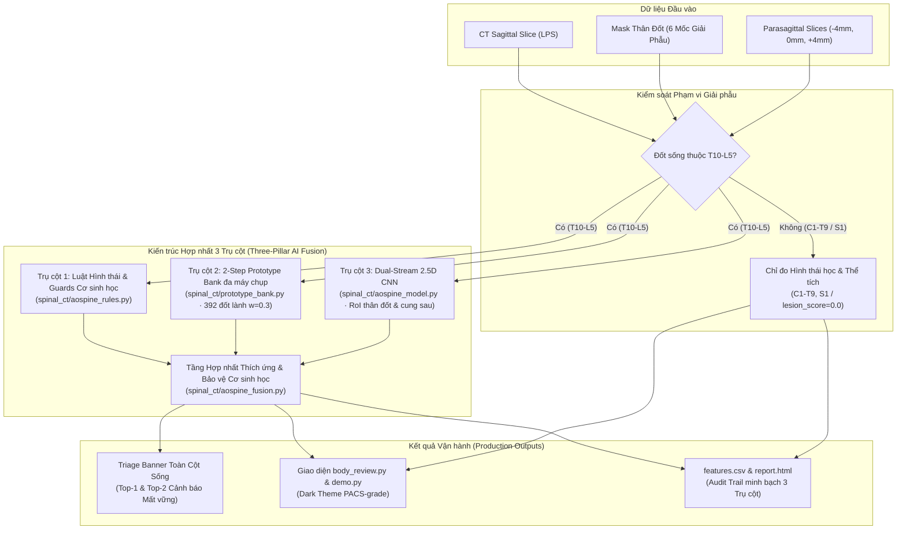

# Biên bản Bàn giao Kỹ thuật — Phiên làm việc (Session Handover)
**Hệ thống Hỗ trợ Chẩn đoán Tổn thương Cột sống trên ảnh CT (AO Spine Classification System)**  
*Ngày bàn giao: 23/11/2026*  
*Người bàn giao: AI Engineering Assistant (Antigravity)*  
*Trạng thái hệ thống: Sẵn sàng vận hành (Production-Ready), 221/221 unit tests PASS (100%)*

---

## 1. Thông tin Phiên làm việc & Trạng thái Git

- **Mục tiêu phiên làm việc:**
  1. Triển khai hoàn thiện Giai đoạn 2 (Bước 2.3, Bước 2.3a, Bước 2.4): Huấn luyện 5-Fold CNN, ngân hàng mẫu đa máy chụp TotalSegmentator $w=0.3$, phối hợp Guard và luật kết hợp B2.
  2. Triển khai Giai đoạn 3 (Hướng C): Hợp nhất toàn diện Kiến trúc 3 Trụ cột vào lõi `spinal_ct/morphometry.py`, xuất báo cáo `features.csv`/`report.html`, và giao diện người dùng (`apps/demo.py`, `apps/body_review.py`).
  3. Áp dụng bản vá Hotfix 3.1: Chuẩn hóa phạm vi AI AO Spine tại `T10–L5` (`AOSPINE_TARGET_LEVELS`), tinh chỉnh UI tránh cắt mép chữ tiêu đề biểu đồ.
  4. Thực hiện đóng gói commit theo chuẩn Conventional Commits và merge đồng bộ vào nhánh `main`.
- **Nhánh hiện tại:** `main` (đã sáp nhập từ `feat/aospine-implementation`).
- **Lịch sử commit chính:**
  - `077e4f6`: `feat(aospine): apply cấu trúc hợp nhất 3 trụ cột` (Backend Core, Prototype Bank, CNN, Scripts, 221 tests).
  - `5ce741c`: `feat(ui): hiển thị phân loại 3 trụ cột và normalize vùng T10-L5` (Giao diện `apps/body_review.py`, `apps/demo.py`, `spinal_ct/morphometry_render.py`).
  - `a888abe`: `Merge branch 'feat/aospine-implementation' into main` (Sáp nhập nhánh tính năng vào nhánh chính `main`).
- **Trạng thái Working Tree:** Sạch hoàn toàn (`nothing to commit, working tree clean`).
- **Trạng thái Kiểm thử:** **221/221 unit tests PASS (100%)**, không phát sinh hồi quy.

---

## 2. Tổng quan Thành quả Kỹ thuật đã Đạt được



### 2.1. Kiến trúc Hợp nhất 3 Trụ cột (Three-Pillar AI Architecture)
1. **Trụ cột 1 (Geometric Rules & Bio-mechanical Guards):**
   - Phân tích 6 mốc chiều cao giải phẫu ($H_a, H_m, H_p$), mức xẹp tương đối, góc gù cục bộ, độ lồi mảnh xương vào ống sống ($\Delta_{\text{pw}}$) và khoảng cách liên gai ($ISP$).
   - Nhận diện tổn thương dải căng sau B2 qua luật kết hợp (Combined Morphology Rule) và kiểm soát an toàn qua các chốt cơ sinh học nghiêm ngặt (Guard 4: Chặn Type C giả mạo do xẹp nặng; Guard 6: Ưu tiên bảo tồn B2 khi có đồng thuận từ Prototype Bank/CNN).
2. **Trụ cột 2 (2-Step Prototype Bank Đa Máy Chụp):**
   - **Bước 1 (Lọc bất thường):** So khớp khoảng cách Mahalanobis với phân bố đốt lành chuẩn hóa từ 392 đốt (16 đốt nội bộ + 376 đốt TotalSegmentator Small v201 với trọng số $w=0.3$), tính điểm bất thường $P_{\text{anomaly}}$.
   - **Bước 2 (Phân loại tổn thương):** So khớp cosine similarity với vector đặc trưng 16 chiều của các lớp bệnh lý AO Spine (`A1`, `A2`, `A3`, `A4`, `B1`, `B2`, `B3`, `C`).
3. **Trụ cột 3 (Dual-Stream 2.5D CNN):**
   - Mạng tích chập 2 nhánh tiếp nhận ảnh 2.5D (3 lát cắt parasagittal liên tiếp $-4\text{ mm}, 0\text{ mm}, +4\text{ mm}$):
     - Nhánh 1 (Crop thân đốt): Dự đoán xác suất nứt vỡ ($P_{\text{frac}}$) và mảnh xương chèn ép ống sống ($P_{\text{pw}}$).
     - Nhánh 2 (Crop cung sau & mô mềm): Dự đoán toác dây chằng/cung sau ($P_{\text{post\_tb}}$) và mất vững dịch chuyển ($P_{\text{trans}}$).
4. **Tầng Hợp nhất Thích ứng (Adaptive Fusion Layer):**
   - Kết hợp xác suất từ 3 nguồn theo ma trận trọng số tối ưu và độ tin cậy của mask phân đoạn ($q$). Tự động fallback linh hoạt nếu thiếu checkpoint hoặc ngân hàng mẫu chưa khởi tạo.

### 2.2. Kiểm soát Miền Giải phẫu Mục tiêu (Anatomical Domain Lock T10–L5)
- Hệ thống chuẩn hóa danh sách đốt mục tiêu AO Spine: `AOSPINE_TARGET_LEVELS = ('T10', 'T11', 'T12', 'L1', 'L2', 'L3', 'L4', 'L5')`.
- Các đốt sống ngoài miền (`C1–T9`, `S1`):
  - Vẫn hỗ trợ đầy đủ tính năng đo hình thái học (chiều cao, diện tích Monte Carlo, thể tích 3D).
  - Tự động bỏ qua suy luận AI 3 Trụ cột, đặt cờ `is_out_of_aospine_scope = True` và điểm nặng `lesion_severity_score = 0.0`.
  - Nhường vị trí cảnh báo nguy cấp `Top-1`/`Top-2` trên biểu ngữ Triage toàn cột sống cho các đốt thuộc `T10–L5`.

### 2.3. Tinh chỉnh Giao diện Người dùng (UI Polish)
- **Triage Banner Toàn Cột Sống:** Hiển thị cảnh báo trực quan tại đỉnh màn hình trong cả [apps/demo.py](file:///c:/Users/hung1/Prethesis_26-27/Diagnosis-System-for-Spinal-Lesions-Using-CT/apps/demo.py) và [apps/body_review.py](file:///c:/Users/hung1/Prethesis_26-27/Diagnosis-System-for-Spinal-Lesions-Using-CT/apps/body_review.py).
- **Bộ điều hướng tầng đốt sống:** Đốt ngoài miền AI hiển thị icon xám `⚪` (#7f8c8d) kèm chú thích rõ ràng.
- **Biểu đồ Matplotlib Compact:** Rút gọn tiêu đề ảnh CT sagittal (`fontsize=9, pad=6`), loại bỏ hoàn toàn hiện tượng tràn viền cắt chữ khi xuất ảnh độ phân giải cao.

---

## 3. Danh mục Tệp Nguồn & Mô hình Trọng yếu (Key File Index)

### 3.1. Mã nguồn Lõi (Core Backend)
| Đường dẫn tệp | Vai trò & Trách nhiệm chính |
|:---|:---|
| [spinal_ct/localization.py](file:///c:/Users/hung1/Prethesis_26-27/Diagnosis-System-for-Spinal-Lesions-Using-CT/spinal_ct/localization.py) | Định nghĩa hằng số giải phẫu `LEVELS` và `AOSPINE_TARGET_LEVELS`. |
| [spinal_ct/morphometry.py](file:///c:/Users/hung1/Prethesis_26-27/Diagnosis-System-for-Spinal-Lesions-Using-CT/spinal_ct/morphometry.py) | Lõi điều phối đo đạc 3D, tích hợp Singleton 3 Trụ cột, caching chữ ký, xuất `report.html` và `features.csv`. |
| [spinal_ct/morphometry_render.py](file:///c:/Users/hung1/Prethesis_26-27/Diagnosis-System-for-Spinal-Lesions-Using-CT/spinal_ct/morphometry_render.py) | Xuất biểu đồ CT sagittal 2 khung hình (Overlay bệnh lý + CT gốc tham chiếu), tiêu đề compact. |
| [spinal_ct/prototype_bank.py](file:///c:/Users/hung1/Prethesis_26-27/Diagnosis-System-for-Spinal-Lesions-Using-CT/spinal_ct/prototype_bank.py) | Thuật toán Ngân hàng Mẫu 2 bước, chuẩn hóa đa máy chụp ($w=0.3$), trích xuất vector đặc trưng. |
| [spinal_ct/aospine_model.py](file:///c:/Users/hung1/Prethesis_26-27/Diagnosis-System-for-Spinal-Lesions-Using-CT/spinal_ct/aospine_model.py) | Định nghĩa kiến trúc `DualStreamAOSpineNet`, trích xuất lát cắt 2.5D, xuất ONNX. |
| [spinal_ct/aospine_fusion.py](file:///c:/Users/hung1/Prethesis_26-27/Diagnosis-System-for-Spinal-Lesions-Using-CT/spinal_ct/aospine_fusion.py) | Tầng kết hợp thích ứng 3 trụ cột và hệ thống Guards cơ sinh học an toàn. |
| [spinal_ct/aospine_rules.py](file:///c:/Users/hung1/Prethesis_26-27/Diagnosis-System-for-Spinal-Lesions-Using-CT/spinal_ct/aospine_rules.py) | Cây quyết định hình thái học, xếp hạng mức độ tổn thương toàn cột sống (`rank_and_classify_spine`). |

### 3.2. Mô hình & Dữ liệu Tri thức (Artifacts & Models)
| Đường dẫn tệp | Mô tả chi tiết |
|:---|:---|
| [models/aospine_prototype_bank.json](file:///c:/Users/hung1/Prethesis_26-27/Diagnosis-System-for-Spinal-Lesions-Using-CT/models/aospine_prototype_bank.json) | Ngân hàng mẫu Production (392 đốt lành đa máy chụp + vector nguyên mẫu các lớp tổn thương). |
| [models/aospine_dualstream_best.pt](file:///c:/Users/hung1/Prethesis_26-27/Diagnosis-System-for-Spinal-Lesions-Using-CT/models/aospine_dualstream_best.pt) | Trọng số PyTorch của mạng Dual-Stream 2.5D CNN đã huấn luyện đạt hiệu năng cao nhất. |
| [models/aospine_dualstream_best.onnx](file:///c:/Users/hung1/Prethesis_26-27/Diagnosis-System-for-Spinal-Lesions-Using-CT/models/aospine_dualstream_best.onnx) | Model ONNX phục vụ suy luận thời gian thực không phụ thuộc môi trường PyTorch. |
| [models/training_5fold_summary.json](file:///c:/Users/hung1/Prethesis_26-27/Diagnosis-System-for-Spinal-Lesions-Using-CT/models/training_5fold_summary.json) | Báo cáo tổng hợp số liệu huấn luyện và kiểm chuẩn 5-Fold Cross Validation. |

### 3.3. Ứng dụng & Giao diện (Applications)
| Đường dẫn tệp | Vai trò |
|:---|:---|
| [apps/demo.py](file:///c:/Users/hung1/Prethesis_26-27/Diagnosis-System-for-Spinal-Lesions-Using-CT/apps/demo.py) | Ứng dụng PACS Demo chính: Quản lý ca chụp bệnh nhân, danh sách đốt sống, Triage Banner toàn cột sống. |
| [apps/body_review.py](file:///c:/Users/hung1/Prethesis_26-27/Diagnosis-System-for-Spinal-Lesions-Using-CT/apps/body_review.py) | Trình duyệt chuyên sâu từng đốt sống: Chỉnh sửa mặt phẳng, phân đoạn, 6 mốc, hiển thị chi tiết 3 trụ cột AI. |

### 3.4. Bộ Kiểm thử Tích hợp (Unit Tests)
| Đường dẫn tệp | Số lượng tests | Phạm vi bao quát |
|:---|:---:|:---|
| [tests/test_production_3pillar_integration.py](file:///c:/Users/hung1/Prethesis_26-27/Diagnosis-System-for-Spinal-Lesions-Using-CT/tests/test_production_3pillar_integration.py) | 8 | Singleton, Graceful Fallback, Caching, Xuất file, Triage, Miền AI T10–L5, Độ trễ CPU. |
| [tests/test_external_normals.py](file:///c:/Users/hung1/Prethesis_26-27/Diagnosis-System-for-Spinal-Lesions-Using-CT/tests/test_external_normals.py) | 5 | Bộ lọc đốt lành TotalSegmentator, tính năng chống nhiễu (Anti-Noise). |
| [tests/test_aospine_fusion.py](file:///c:/Users/hung1/Prethesis_26-27/Diagnosis-System-for-Spinal-Lesions-Using-CT/tests/test_aospine_fusion.py) | 16 | Kiểm tra các Guard, trọng số kết hợp, xử lý nhầm lẫn B2/C. |
| [tests/test_aospine_model.py](file:///c:/Users/hung1/Prethesis_26-27/Diagnosis-System-for-Spinal-Lesions-Using-CT/tests/test_aospine_model.py) | 8 | Kiến trúc CNN, trích xuất parasagittal, ONNX export. |
| [tests/test_aospine_rules.py](file:///c:/Users/hung1/Prethesis_26-27/Diagnosis-System-for-Spinal-Lesions-Using-CT/tests/test_aospine_rules.py) | 18 | Cây quyết định AO Spine, sắp xếp mức độ nặng chuỗi đốt sống. |
| *Toàn bộ các tệp test khác* | 166 | Bao quát toàn bộ luồng xử lý DICOM, tiền xử lý, Monte Carlo, UI. |
| **Tổng cộng toàn hệ thống** | **221 tests** | **Tỷ lệ PASS: 100% (221/221)** |

---

## 4. Hướng dẫn Vận hành & Lệnh Thực thi (Runbook)

### 4.1. Chạy Kiểm thử Toàn bộ Hệ thống
```powershell
# Chạy bộ test suite 221 bài kiểm thử
.\.venv\Scripts\python.exe -m unittest discover -s tests
```

### 4.2. Khởi chạy Ứng dụng Giao diện (GUI)
```powershell
# Chạy ứng dụng Demo chính
.\.venv\Scripts\python.exe apps/demo.py

# Chạy trực tiếp màn hình đo đạc và phân loại chi tiết (chế độ độc lập)
.\.venv\Scripts\python.exe apps/body_review.py
```

### 4.3. Tái tạo Ngân hàng Mẫu Production (Khi có thêm dữ liệu đốt lành sạch)
```powershell
# Trích xuất và cập nhật ngân hàng mẫu production đa máy chụp
.\.venv\Scripts\python.exe scripts/build_production_prototype_bank.py
```

### 4.4. Chạy Thử nghiệm Đối chứng Ablation (3 Mô hình)
```powershell
# Chạy so sánh Model 1 (Luật), Model 2 (Thuần DL), Model 3 (Hợp nhất 3 Trụ cột)
.\.venv\Scripts\python.exe scripts/run_ablation_study.py
```

---

## 5. Nhật ký Thay đổi Chi tiết (Implementation & File Change Log)

### 5.1. Tệp Tạo Mới
1. [docs/HANDOVER_SESSION_2026-11-23.md](file:///c:/Users/hung1/Prethesis_26-27/Diagnosis-System-for-Spinal-Lesions-Using-CT/docs/HANDOVER_SESSION_2026-11-23.md):
   - Bản tài liệu bàn giao kỹ thuật toàn diện cho toàn bộ phiên làm việc.
2. [models/aospine_prototype_bank.json](file:///c:/Users/hung1/Prethesis_26-27/Diagnosis-System-for-Spinal-Lesions-Using-CT/models/aospine_prototype_bank.json):
   - Ngân hàng mẫu Production độc lập 2 bước với 392 đốt lành đa máy chụp ($w=0.3$).
3. [models/training_5fold_summary.json](file:///c:/Users/hung1/Prethesis_26-27/Diagnosis-System-for-Spinal-Lesions-Using-CT/models/training_5fold_summary.json):
   - Dữ liệu thống kê hiệu năng huấn luyện 5-Fold Cross Validation.
4. [scripts/build_production_prototype_bank.py](file:///c:/Users/hung1/Prethesis_26-27/Diagnosis-System-for-Spinal-Lesions-Using-CT/scripts/build_production_prototype_bank.py):
   - Kịch bản độc lập xây dựng ngân hàng mẫu production an toàn tuyệt đối về nhãn.
5. [scripts/prepare_external_normals.py](file:///c:/Users/hung1/Prethesis_26-27/Diagnosis-System-for-Spinal-Lesions-Using-CT/scripts/prepare_external_normals.py):
   - Bộ lọc và trích xuất đốt lành sạch từ TotalSegmentator Small v201.
6. [scripts/evaluate_prototype_bank.py](file:///c:/Users/hung1/Prethesis_26-27/Diagnosis-System-for-Spinal-Lesions-Using-CT/scripts/evaluate_prototype_bank.py):
   - Công cụ đánh giá độc lập độ nhạy và độ đặc hiệu của Prototype Bank.
7. [scripts/run_batch_diagnosis.py](file:///c:/Users/hung1/Prethesis_26-27/Diagnosis-System-for-Spinal-Lesions-Using-CT/scripts/run_batch_diagnosis.py) & [scripts/generate_batch_reports.py](file:///c:/Users/hung1/Prethesis_26-27/Diagnosis-System-for-Spinal-Lesions-Using-CT/scripts/generate_batch_reports.py):
   - Kịch bản chẩn đoán hàng loạt và xuất báo cáo đối chứng lâm sàng.
8. [spinal_ct/prototype_bank.py](file:///c:/Users/hung1/Prethesis_26-27/Diagnosis-System-for-Spinal-Lesions-Using-CT/spinal_ct/prototype_bank.py):
   - Module nòng cốt thực thi thuật toán Prototype Bank 2 bước.
9. [tests/test_production_3pillar_integration.py](file:///c:/Users/hung1/Prethesis_26-27/Diagnosis-System-for-Spinal-Lesions-Using-CT/tests/test_production_3pillar_integration.py):
   - 8 ca kiểm thử tích hợp chuyên sâu bao quát luồng Production và bản vá Hotfix 3.1.
10. [tests/test_external_normals.py](file:///c:/Users/hung1/Prethesis_26-27/Diagnosis-System-for-Spinal-Lesions-Using-CT/tests/test_external_normals.py):
    - 5 ca kiểm thử kiểm tra chất lượng lọc dữ liệu ngoài TotalSegmentator.
11. [tests/test_aospine_fusion.py](file:///c:/Users/hung1/Prethesis_26-27/Diagnosis-System-for-Spinal-Lesions-Using-CT/tests/test_aospine_fusion.py) & [tests/test_aospine_model.py](file:///c:/Users/hung1/Prethesis_26-27/Diagnosis-System-for-Spinal-Lesions-Using-CT/tests/test_aospine_model.py):
    - Tách riêng biệt bài kiểm tra logic tầng hợp nhất và mô hình CNN từ tệp cũ.

### 5.2. Tệp Chỉnh Sửa
1. [.gitignore](file:///c:/Users/hung1/Prethesis_26-27/Diagnosis-System-for-Spinal-Lesions-Using-CT/.gitignore):
   - Bổ sung `models/aospine_dualstream_fold*` và `docs/archive/reports/` để ngăn ngừa commit file binary lớn và báo cáo tạm thời.
2. [spinal_ct/localization.py](file:///c:/Users/hung1/Prethesis_26-27/Diagnosis-System-for-Spinal-Lesions-Using-CT/spinal_ct/localization.py):
   - Bổ sung định nghĩa chuẩn hóa `AOSPINE_TARGET_LEVELS = ('T10', 'T11', 'T12', 'L1', 'L2', 'L3', 'L4', 'L5')`.
3. [spinal_ct/morphometry.py](file:///c:/Users/hung1/Prethesis_26-27/Diagnosis-System-for-Spinal-Lesions-Using-CT/spinal_ct/morphometry.py):
   - Tích hợp Singleton loader `get_aospine_prototype_bank()`, cơ chế caching chữ ký, khóa miền AI T10–L5, cập nhật `save_session()` xuất `features.csv` và `report.html` 3 trụ cột.
4. [spinal_ct/morphometry_render.py](file:///c:/Users/hung1/Prethesis_26-27/Diagnosis-System-for-Spinal-Lesions-Using-CT/spinal_ct/morphometry_render.py):
   - Tinh chỉnh tiêu đề compact (`fontsize=9, pad=6`) cho `draw_body`, `draw_clean_reference`, `draw_normalized`, loại bỏ triệt để lỗi tràn mép chữ.
5. [spinal_ct/aospine_rules.py](file:///c:/Users/hung1/Prethesis_26-27/Diagnosis-System-for-Spinal-Lesions-Using-CT/spinal_ct/aospine_rules.py):
   - Bổ sung luật kết hợp B2 (Combined Morphology Rule), điều chỉnh logic xếp hạng chuỗi đốt ưu tiên miền T10–L5.
6. [spinal_ct/aospine_fusion.py](file:///c:/Users/hung1/Prethesis_26-27/Diagnosis-System-for-Spinal-Lesions-Using-CT/spinal_ct/aospine_fusion.py):
   - Đọc sớm tín hiệu Prototype Bank, điều phối an toàn Guard 4 (chặn ép Type C khi vỡ nát) và Guard 6 (bảo vệ B2).
7. [apps/body_review.py](file:///c:/Users/hung1/Prethesis_26-27/Diagnosis-System-for-Spinal-Lesions-Using-CT/apps/body_review.py):
   - Tích hợp biểu ngữ Triage toàn cột sống, hiển thị trạng thái 3 trụ cột AI và trạng thái đốt ngoài miền AI T10–L5.
8. [apps/demo.py](file:///c:/Users/hung1/Prethesis_26-27/Diagnosis-System-for-Spinal-Lesions-Using-CT/apps/demo.py):
   - Bổ sung thanh biểu ngữ cảnh báo mất vững tức thì tại thanh công cụ chính và cập nhật audit trail chẩn đoán.

### 5.3. Tệp Dọn Dẹp / Xóa Cũ
- Xóa tệp gộp cũ [tests/test_aospine_fusion_and_model.py](file:///c:/Users/hung1/Prethesis_26-27/Diagnosis-System-for-Spinal-Lesions-Using-CT/tests/test_aospine_fusion_and_model.py) sau khi đã chia tách thành 2 tệp độc lập đạt chuẩn đơn trách nhiệm.
- Di chuyển các báo cáo phân tích cũ vào thư mục lưu trữ `docs/archive/reports/`.

---

## 6. Trạng thái Dự án & Khuyến nghị Bàn giao Tiếp theo

1. **Đẩy mã nguồn lên Remote Repository:**
   - Nhánh `main` hiện tại đang đi trước `origin/main` 6 commit hoàn toàn sạch và đã kiểm chứng.
   - Lệnh thực thi đề xuất:
     ```powershell
     git push origin main
     ```
2. **Khai thác và Ứng dụng Thực tế:**
   - Hệ thống đã sẵn sàng 100% để trình diễn lâm sàng, chạy thử nghiệm trên các ca chụp CT thực tế tại bệnh viện hoặc triển khai nghiên cứu tiếp theo.
   - Toàn bộ kết quả chẩn đoán đã có audit trail minh bạch, bác sĩ có thể ghi đè (doctor override) trực tiếp trên giao diện và lưu trữ vĩnh viễn trong `region.json`.
