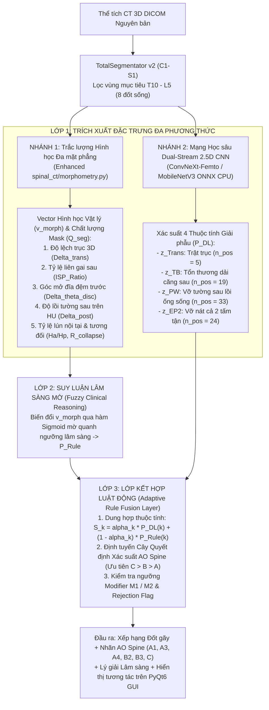

# Đặc tả Kiến trúc & Giải pháp Kỹ thuật: Hệ thống Phát hiện và Phân loại Tổn thương Cột sống theo Chuẩn AO Spine

> **Mục đích tài liệu:** Tài liệu này là **Bản Đặc tả Kiến trúc Chuẩn (Master Technical Specification)** dùng làm ngữ cảnh đầu vào (Context) cho các phiên lập trình, huấn luyện mô hình và viết luận văn tiếp theo của dự án `Diagnosis-System-for-Spinal-Lesions-Using-CT`.
>
> **Dự án:** Development of a Deep Learning-Based Computer-Aided Diagnosis System for Spinal Lesions Using CT  
> **Repository:** `https://github.com/thaong2005/Diagnosis-System-for-Spinal-Lesions-Using-CT`  
> **Nền tảng mục tiêu:** Windows 11, Python 3.13, CPU-first Inference ($\le 1.0\text{s}$), PyQt6 GUI (`apps/body_review.py`, `apps/demo.py`)  
> **Phạm vi giải phẫu & Nhãn:** Đốt sống ngực – thắt lưng (**T10 – L5**); 6 lớp mục tiêu trong tập dữ liệu (**`A1`**, **`A3`**, **`A4`**, **`B2`**, **`B3`**, **`C`**) mở rộng cho toàn bộ cây AO Spine (`Normal`, `A0`, `A2`, `B1` và Modifiers `M1`, `M2`).

---

## 1. Hợp đồng Suy luận Thực tế (Production Contract — Bất biến)

1. **Đầu vào duy nhất (Inference Input):** Thư mục chứa ảnh CT DICOM 3D nguyên bản của bệnh nhân.
2. **Nghiêm cấm rò rỉ nhãn (Zero Label Leakage):** Trong suốt quá trình suy luận, hệ thống tuyệt đối không được đọc file CSV nhãn lâm sàng, không được biết trước bệnh nhân gãy đốt nào (ví dụ: không được mớm trước `L1`), không nhận bounding box thủ công.
3. **Đầu ra bắt buộc (System Output):**
   - Danh sách các đốt sống vùng **T10 – L5** được xếp hạng theo mức độ nghi ngờ tổn thương (Vertebra-level Injury Ranking).
   - Với mỗi đốt sống: Vùng không gian (2D/3D ROI), các chỉ số hình thái học định lượng, điểm xác suất của 4 thuộc tính giải phẫu, mã phân loại **AO Spine** dự đoán, điểm tin cậy (Confidence Score), và cờ cảnh báo lâm sàng (**`Modifier M1/M2`** hoặc **`Indeterminate / Reject`** nếu ảnh nhiễu nặng).
4. **Đánh giá độc lập:** File ground-truth (`data ngay 27.09.2026.xlsx` / CSV gồm 54 ca) chỉ được đối chiếu **sau khi pipeline đã xuất kết quả cuối cùng**.

---

## 2. Chuẩn Lâm sàng AO Spine & Các Quy tắc Giải phẫu Cốt lõi trên Ảnh CT

Dựa trên hệ thống phân loại chấn thương cột sống ngực – thắt lưng của **AO Spine** (*Vaccaro et al., 2013; AO Foundation; Radiology Assistant*), hệ thống áp dụng **Thứ bậc Ưu tiên Độ nặng ($C > B > A > Normal$)** và **4 Quy tắc Lâm sàng Bắt buộc**:

### 2.1. Bảng Tiêu chí Hình thái học & Dấu hiệu CT Định lượng

| Nhóm / Mã | Tên Lâm sàng | Bản chất Cơ sinh học | Tiêu chí Định lượng trên CT (Morphometric & Visual Criteria) |
|:---:|---|---|---|
| **Normal / A0** | Bình thường / Gãy phụ không đáng kể | Thân đốt và dải căng nguyên vẹn | • Tỷ lệ chiều cao thân đốt bảo toàn ($H_a/H_p > 0.80$, $R_{\text{collapse}} > 0.85$) • Tường sau phẳng liên tục ($\Delta_{\text{posterior}} \le 1.5\text{ mm}$) |
| **A1** | Gãy lún chêm (*Wedge Compression*) | Nén ép **1 tấm tận**, tường sau nguyên vẹn | • Sụt giảm chiều cao trước/giữa ($H_a/H_p \le 0.80$ hoặc góc chêm $\alpha_{\text{wedge}} \ge 10^\circ$) • Chỉ tổn thương **1 tấm tận** (thường là tấm tận trên) • **Tường sau hoàn toàn nguyên vẹn** ($\Delta_{\text{posterior}} \le 1.5\text{ mm}$) |
| **A2** | Gãy chẻ / Tách (*Split / Pincer*) | Đường gãy dọc qua **2 tấm tận**, tường sau nguyên vẹn | • Khuyết xương dọc qua cả tấm tận trên và dưới • **Tường sau hoàn toàn nguyên vẹn** |
| **A3** | Gãy nhiều mảnh không hoàn toàn (*Incomplete Burst*) | Vỡ **1 tấm tận** + **Vỡ tường sau** đẩy vào ống sống | • Mảnh xương tường sau bật lồi vào lòng ống sống ($\Delta_{\text{posterior}} > 2.0\text{ mm}$) • Vỡ nát **1 tấm tận** (tấm tận còn lại nguyên vẹn) |
| **A4** | Gãy nhiều mảnh hoàn toàn (*Complete Burst*) | Vỡ **cả 2 tấm tận** + **Vỡ tường sau** đẩy vào ống sống | • Mảnh xương tường sau vỡ nát lồi vào ống sống ($\Delta_{\text{posterior}} > 2.0\text{ mm}$) • Sập lún / vỡ nát **cả tấm tận trên và dưới** (kiểm tra qua $R_{\text{collapse}}$ so với đốt lân cận) |
| **B1** | Gãy Chance (*Pure Osseous Tension Band*) | Đứt dải căng sau thuần túy qua xương | • Đường gãy ngang đi từ mỏm gai qua mảnh sống, cuống cung vào thân đốt trên 1 đốt duy nhất |
| **B2** | Tổn thương dải căng sau Xương – Dây chằng (*Posterior Osseoligamentous*) | Đứt phức hợp dây chằng sau (PLC) $\pm$ gãy cung sau, kèm gãy thân đốt loại A | • **Toác rộng khoảng cách liên gai sau** theo trục dọc ($\text{ISP Ratio} > 1.30$) • Hoặc há rộng/bán trật khớp mấu bên (*facet joint widening*) • Thường đi kèm gãy thân đốt `A1`–`A4` ở phía trước |
| **B3** | Tổn thương dải căng trước (*Hyperextension*) | Căng giãn quá mức làm rách dây chằng dọc trước (ALL) | • **Toác rộng góc khe đĩa đệm phía trước** ($\Delta\theta_{\text{disc}} > 15^\circ$, $d_{\text{disc\_ant}} / d_{\text{disc\_post}} > 2.5$) • Thường đi kèm cầu xương trước cột sống (DISH / Viêm cột sống dính khớp — **M2**) |
| **C** | Gãy trật (*Translation / Displacement*) | Mất vững hoàn toàn 3 cột, trượt hoặc xoay trục | • **Độ di lệch tịnh tiến** tâm/bờ thân đốt giữa 2 đốt liền kề $\Delta_{\text{translation}} > 3.0\text{ mm}$ trên mặt phẳng Sagittal hoặc Coronal, hoặc xoay trục trên Axial |

### 2.2. 4 Quy tắc Lâm sàng Đặc biệt Cần Lập trình vào Hệ thống
1. **Quy tắc Gán nhãn Kết hợp của Lớp B2 (Combined Morphology Priority):**
   - Trong thực tế lâm sàng (và trong 14 ca `B2` của tập dữ liệu), tổn thương `B2` hầu hết đi kèm gãy thân đốt kiểu `A1`, `A3` hoặc `A4`.
   - **Luật bắt buộc:** Nếu một đốt sống vừa thỏa mãn tiêu chí vỡ tường sau/tấm tận của `A3/A4`, vừa có dấu hiệu đứt dải căng sau của `B2` ($\text{ISP Ratio} > 1.30$), hệ thống bắt buộc phải xếp vào nhãn chính là **`B2`** (theo thứ tự ưu tiên $C > B > A$) và xuất ghi chú phụ: *"B2 (kèm tổn thương thân đốt kiểu A3/A4)"*.
2. **Tránh bẫy "Nứt dọc mảnh sống" (Vertical Laminar Fracture Pitfall):**
   - Gãy vỡ nhiều mảnh `A3` và `A4` thường làm 2 cuống cung banh rộng sang hai bên, gây ra đường nứt **dọc** qua mảnh sống (vertical laminar split). Đây **không phải** là tổn thương dải căng nhóm `B`.
   - **Luật bắt buộc:** Chỉ phân loại vào `B2` khi có sự **tách giãn theo phương dọc trục đầu-chân (craniocaudal distraction)** làm toác khoảng liên gai hoặc khớp mấu bên.
3. **Cờ cảnh báo `Modifier M1` (Nghi ngờ Tổn thương Dây chằng Sau):**
   - Khi đốt sống có gãy kiểu `A` (như `A3`, `A4`) và tỷ lệ khoảng cách liên gai nằm trong **vùng xám nghi ngờ ($1.15 < \text{ISP Ratio} \le 1.30$)**, hệ thống giữ nguyên nhãn `A3/A4` nhưng bật cờ **`[Modifier M1: Indeterminate PLC injury - Khuyến nghị kiểm tra MRI]`**.
4. **Cờ cảnh báo `Modifier M2` (Bệnh lý Cột sống Cứng khớp đi kèm B3):**
   - Khi phát hiện cầu xương nối liền bờ trước các đốt sống kèm toác khe trước, bật cờ **`[Modifier M2: Ankylosing Spine / DISH]`** để củng cố độ tin cậy cho lớp **`B3`**.

---

## 3. Phân tích 6 Lỗ hổng của Thiết kế Ban đầu & Giải pháp Khắc phục

| STT | Lỗ hổng trong Thiết kế Ban đầu | Hệ quả Thực tế | Giải pháp Khắc phục Triệt để |
|:---:|---|---|---|
| **1** | **`morphometry.py` cắt bỏ hoàn toàn cung sau tại `cut_col`** | Mất toàn bộ mỏm gai và mảnh sống $\to$ không thể đo khoảng cách liên gai ($D_{\text{spinous}}$) để nhận diện lớp **B2**. | Sửa `auto_segment_body` để tách mask đốt sống thành 2 phần riêng biệt: `anterior_body_mask` (cột $\le \text{cut\_col}$) và `posterior_arch_mask` (cột $> \text{cut\_col}$). |
| **2** | **`_largest_anterior_component` xóa mất mảnh xương vỡ rời** | Ở lớp **A3/A4**, mảnh xương tường sau bung rời vào ống sống bị coi là nhiễu và bị xóa $\to$ bờ sau còn lại trông "phẳng" $\to$ nhận nhầm thành **A1**. | Đo độ lồi tường sau ($\Delta_{\text{posterior}}$) trực tiếp trên **giá trị HU của ảnh CT gốc ($\text{HU} > 250$)** vượt qua **Đường giới hạn trước ống sống (Anterior Spinal Canal Line)** nối từ đốt lành trên và dưới. |
| **3** | **Tỷ lệ nội tại $H_a/H_p$ bị mù trước ca lún toàn bộ (A4)** | Khi cả tường trước ($H_a$) và tường sau ($H_p$) cùng sập lún 40% trong ca **A4**, tỷ số $H_a/H_p \approx 1.0$ (giả bình thường). | Bổ sung chỉ số **Sập lún Tương đối ($R_{\text{collapse}}$)** so sánh chiều cao đốt hiện tại với trung bình cộng chiều cao của 2 đốt lành lân cận $(i-1, i+1)$. |
| **4** | **Sụp đổ xác suất về 0 (Zero-Probability Collapse)** | Công thức nhân $P_{\text{DL}}^\lambda \times P_{\text{Rule}}^{1-\lambda}$ luôn trả về $0$ cho lớp **A1 ($n=1$)** và **B3 ($n=1$)** vì Softmax của mạng DL cho lớp 1 mẫu luôn $\approx 0$. | 1. Thay phân loại 6 lớp bằng **Phân rã 4 Thuộc tính Giải phẫu (Concept Decomposition)**. 2. Thay phép nhân bằng **Tổng tuyến tính có trọng số động theo chất lượng mask**. |
| **5** | **Chỉ xét 1 lát cắt 2D Mid-sagittal duy nhất** | Bỏ sót mảnh vỡ tường sau nằm lệch tâm (Parasagittal) của **A3/A4** và bỏ sót trượt bên (Coronal) hoặc xoay trục (Axial) của **C**. | Chuyển sang trích xuất đặc trưng hình học đa mặt phẳng (Multi-planar: Mid-sagittal, $\pm 4\text{ mm}$ Parasagittal, Coronal tâm đốt) và đầu vào **Dual-Stream 2.5D** cho CNN. |
| **6** | **Gán nhãn `Normal` mù quáng & Lỗi chia Fold cho $n=1$** | Các đốt gãy phụ liền kề không ghi trong CSV bị gán nhầm là `Normal`; chia $k$-fold cho lớp $n=1$ gây mất mẫu ở Train hoặc Test. | Lọc bỏ các đốt liền kề ổ gãy có $H_a/H_p < 0.85$ khỏi tập `Normal`; tách 2 ca $A1, B3$ vào **Rare-Class Out-of-Fold Challenge Set** cố định. |

---

## 4. Kiến trúc Đề xuất: AI Đa tầng Phân rã Thuộc tính & Dung hợp Luật Động (Concept-Driven Hybrid Multi-Layer AI)

### 4.1. Chiến lược Phân rã Thuộc tính (Giải quyết triệt để bài toán $n=1$)
Với tập dữ liệu 54 ca ($\text{A4: } 19, \text{A3: } 14, \text{B2: } 14, \text{C: } 5, \text{A1: } 1, \text{B3: } 1$), mạng CNN **không dự đoán 6 lớp trực tiếp** mà học **4 đầu ra nhị phân độc lập (Multi-label Binary Classification Heads)**:
1. **Head 1 (`Fracture / Compression`):** Có gãy nén thân đốt hay không ($\text{Dương tính: toàn bộ } 54 \text{ đốt gãy}$ vs $\text{Âm tính: các đốt Normal sạch}$).
2. **Head 2 (`Posterior Wall Retropulsion - PW`):** Có mảnh vỡ tường sau lồi vào ống sống hay không ($\text{Dương tính: } 19\text{ A4} + 14\text{ A3} = 33\text{ mẫu}$).
3. **Head 3 (`Both Endplates Comminution - EP2`):** Có vỡ cả 2 tấm tận hay không ($\text{Dương tính: } 19\text{ A4} \text{ và các ca C/B2 kèm vỡ hoàn toàn}$ vs $\text{Âm tính: } 14\text{ A3} + 1\text{ A1}$).
4. **Head 4 (`Posterior Tension Band / Translation - TB_Trans`):** Có tổn thương cấu trúc cột sau / mất vững hay không ($\text{Dương tính: } 14\text{ B2} + 5\text{ C} = 19\text{ mẫu}$).

### 4.2. Thiết kế Đầu vào Dual-Stream 2.5D cho Mạng CNN
Để chạy dưới $0.25\text{ giây}$ trên CPU mà vẫn giữ độ phân giải cao cho đường nứt nhỏ, mỗi đốt sống được cắt thành 2 tensor kích thước $5 \times 128 \times 128$:
* **Stream 1 — `Body & Canal ROI` ($5 \times 128 \times 128$):**
  - Bao quanh thân đốt mở rộng ra sau $10\text{ mm}$ (lấy lòng ống sống) và trên/dưới $5\text{ mm}$.
  - 5 kênh gồm: **3 lát Sagittal** (Mid-sagittal và $\pm 4\text{ mm}$ Parasagittal ở cửa sổ xương $WL=400, WW=1800$) + **1 lát Axial** cắt qua 1/3 trên thân đốt (nơi mảnh vỡ tường sau hay lồi vào ống sống nhất) + **1 kênh Binary Mask** của thân đốt.
* **Stream 2 — `Posterior Tension Band ROI` ($5 \times 128 \times 128$):**
  - Bao quanh cuống cung, khớp mấu bên và mỏm gai từ nửa dưới đốt $i-1$ đến nửa trên đốt $i+1$.
  - 5 kênh gồm: **3 lát Sagittal** cửa sổ xương + **2 lát Sagittal cửa sổ mô mềm** ($WL=50, WW=350$) để bắt dấu hiệu tụ máu / phù nề dây chằng liên gai sau hoặc rách dây chằng dọc trước.

### 4.3. Công thức Toán học của Lớp Kết hợp Luật Động (`RuleFusionLayer`)

#### Bước 1: Chấm điểm Chất lượng Phân đoạn ($Q_{\text{seg}} \in [0, 1]$)
Kiểm tra tính toàn vẹn của mask đốt sống từ `TotalSegmentator` (tỷ lệ thể tích so với đốt lân cận, độ liên thông của biên):
- Nếu đốt sống không bị vỡ vụn mất mảnh ($Q_{\text{seg}} \ge 0.8$), ưu tiên luật hình học ($\alpha_k = 0.35$).
- Nếu đốt sống vỡ nát nặng làm biến dạng mask ($Q_{\text{seg}} < 0.5$), tự động tăng trọng số cho mạng CNN ($\alpha_k = 0.75$).

#### Bước 2: Dung hợp Xác suất Thuộc tính Giải phẫu
Với mỗi thuộc tính $k \in \{\text{Trans}, \text{AntTB}, \text{PostTB}, \text{Fracture}, \text{PW}, \text{EP2}\}$:
$$P_{\text{Rule}}(k \mid \mathbf{v}_{\text{morph}}) = \frac{1}{1 + \exp\left(-\frac{m_k - \tau_k}{T_k}\right)}$$
$$S_k = \alpha_k \cdot P_{\text{DL}}(k \mid \text{CT}) + (1 - \alpha_k) \cdot P_{\text{Rule}}(k \mid \mathbf{v}_{\text{morph}})$$
*(Lưu ý: Với $\text{AntTB}$ của lớp $B3$, đặt $\alpha_{\text{AntTB}} = 0.0$ để dựa 100% vào luật đo góc mở đĩa đệm trước và cầu xương M2 do tập train chỉ có 1 mẫu B3).*

#### Bước 3: Định tuyến Cây Quyết định Mờ (Hierarchical Probabilistic Routing)
Tính điểm tin cậy cho từng lớp AO Spine theo đúng nhánh cây quyết định:
$$\begin{aligned}
\text{Score}(\mathbf{C}) &= S_{\text{Trans}} \\
\text{Score}(\mathbf{B3}) &= (1 - S_{\text{Trans}}) \cdot S_{\text{AntTB}} \\
\text{Score}(\mathbf{B2}) &= (1 - S_{\text{Trans}}) \cdot (1 - S_{\text{AntTB}}) \cdot S_{\text{PostTB}} \\
\text{Score}(\mathbf{A4}) &= (1 - S_{\text{BC}}) \cdot S_{\text{Fracture}} \cdot S_{\text{PW}} \cdot S_{\text{EP2}} \\
\text{Score}(\mathbf{A3}) &= (1 - S_{\text{BC}}) \cdot S_{\text{Fracture}} \cdot S_{\text{PW}} \cdot (1 - S_{\text{EP2}}) \\
\text{Score}(\mathbf{A1}) &= (1 - S_{\text{BC}}) \cdot S_{\text{Fracture}} \cdot (1 - S_{\text{PW}}) \cdot (1 - S_{\text{EP2}}) \\
\text{Score}(\mathbf{Normal}) &= (1 - S_{\text{BC}}) \cdot (1 - S_{\text{Fracture}})
\end{aligned}$$
Trong đó $S_{\text{BC}} = \max\left(S_{\text{Trans}}, S_{\text{AntTB}}, S_{\text{PostTB}}\right)$. Nhãn dự đoán cuối cùng là lớp có $\text{Score}$ cao nhất.