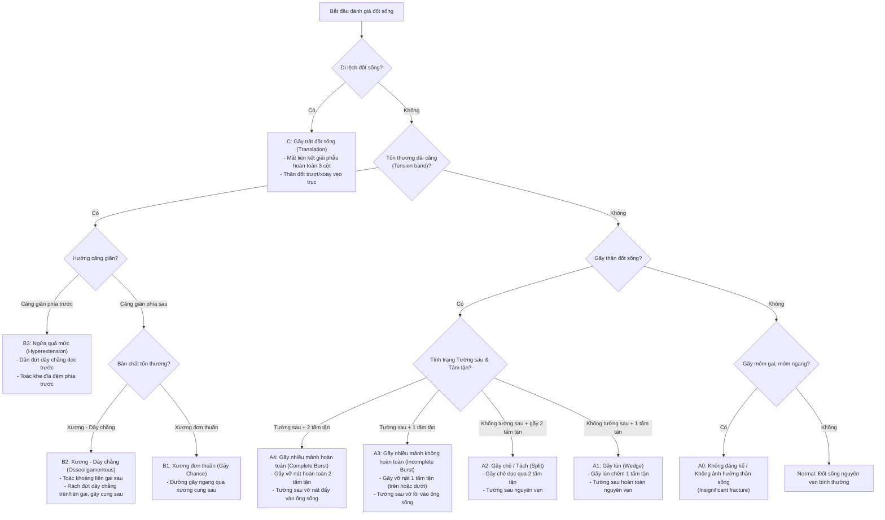
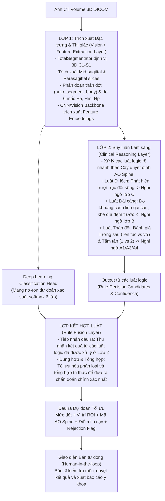
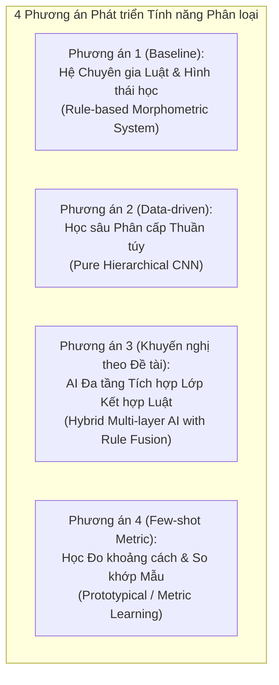
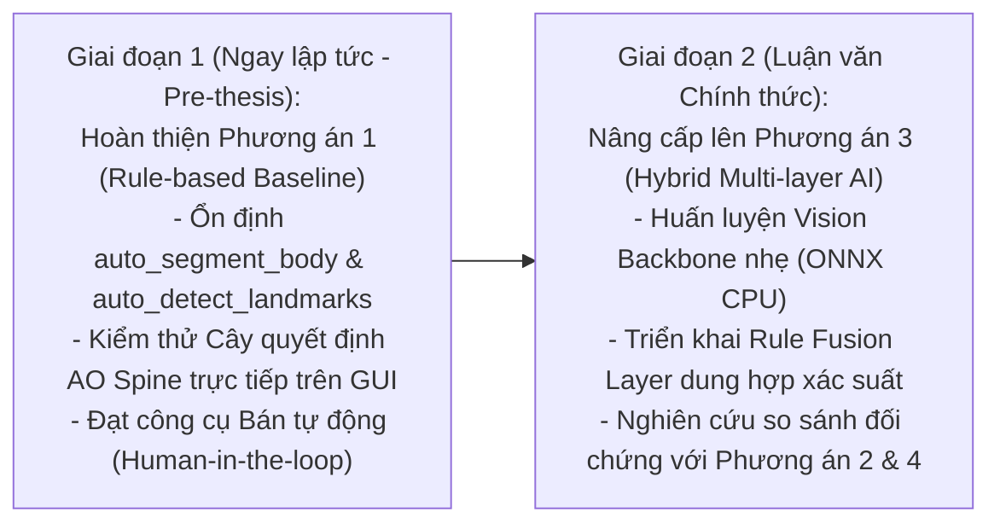

# Bối cảnh & Đặc tả Kỹ thuật: Mô hình Phát hiện và Phân loại Tổn thương Cột sống (AO Spine: A1, A3, A4, B2, B3, C)

> **Mục đích tài liệu:** Tài liệu này được biên soạn chuyên biệt làm **Context đầu vào cho Model / AI Agent chuyên gia tư vấn kiến trúc bên ngoài** (External Advisory Model/Agent). Tài liệu cung cấp toàn bộ bức tranh lâm sàng, cây quyết định phân loại chuẩn AO Spine, hiện trạng mã nguồn, đặc điểm dữ liệu, kiến trúc mô hình AI đa tầng tích hợp luật lâm sàng, các phương án phát triển khả thi, các ràng buộc phần cứng và bộ câu hỏi kỹ thuật trọng tâm cần giải quyết.
>
> **Dự án:** Development of a Deep Learning-Based Computer-Aided Diagnosis System for Spinal Lesions Using CT  
> **Repository:** `Diagnosis-System-for-Spinal-Lesions-Using-CT`  
> **Nền tảng thực thi:** Windows 11, Python 3.13, CPU-first inference, PyQt6 GUI  
> **Tài liệu liên quan trong repo:** [README.md](file:///c:/Users/hung1/Prethesis_26-27/Diagnosis-System-for-Spinal-Lesions-Using-CT/README.md) · [docs/architecture.md](file:///c:/Users/hung1/Prethesis_26-27/Diagnosis-System-for-Spinal-Lesions-Using-CT/docs/architecture.md) · [docs/guides/body_morphometry.md](file:///c:/Users/hung1/Prethesis_26-27/Diagnosis-System-for-Spinal-Lesions-Using-CT/docs/guides/body_morphometry.md) · [Outer_Agent/phan_hoi_tu_van_mo_hinh_ngoai.md](file:///c:/Users/hung1/Prethesis_26-27/Diagnosis-System-for-Spinal-Lesions-Using-CT/Outer_Agent/phan_hoi_tu_van_mo_hinh_ngoai.md)

---

## 1. Định nghĩa Bài toán & Mục tiêu Kỹ thuật

### 1.1. Mục tiêu tổng thể
Hệ thống hướng tới việc xây dựng một đường ống (pipeline) tự động / bán tự động có khả năng:
1. Tiếp nhận **duy nhất một thể tích CT DICOM 3D** của bệnh nhân (không có thông tin gợi ý trước).
2. Tự động định vị các đốt sống vùng ngực – thắt lưng (**T10 – L5**).
3. Phát hiện và xếp hạng (ranking) các đốt sống có dấu hiệu chấn thương, nứt vỡ hoặc xẹp lún.
4. Dự đoán phân loại tổn thương theo hệ thống quốc tế **AO Spine**: **`A1`**, **`A3`**, **`A4`**, **`B2`**, **`B3`**, **`C`** (hoặc gán nhãn `Normal` nếu đốt lành lặn, mở rộng cho toàn bộ cây quyết định AO Spine gồm cả `A0, A2, B1`).
5. Trả về kết quả kèm **vùng không gian (ROI/Bounding box)**, **điểm tin cậy (Confidence score)** và **trạng thái từ chối (Rejection/Indeterminate state)** khi chất lượng ảnh không đủ điều kiện.

### 1.2. Hợp đồng Suy luận Thực tế (Production Contract - Bất biến)
- **Input duy nhất:** Thư mục ảnh DICOM nguyên bản của bệnh nhân.
- **Nghiêm cấm trong inference:** Không được nhận file CSV nhãn, không nhận trước vị trí đốt gãy (ví dụ: không được mớm trước rằng bệnh nhân bị gãy L1), không nhận bounding box thủ công, không nhận mã phân loại.
- **Đánh giá khách quan:** File ground truth lâm sàng chỉ được mở **sau khi mô hình đã hoàn tất suy luận** để tính toán các chỉ số độ chính xác (Top-k accuracy, F1-score, Confusion Matrix).

---

## 2. Cây Quyết định Phân loại Tổn thương theo Hệ thống AO Spine

Theo thuyết minh đề tài nghiên cứu (`thuyet minh de tai ver4.pptx`), quy trình chẩn đoán lâm sàng tổn thương cột sống ngực – thắt lưng được chuẩn hóa thành một **Cây quyết định (Decision Tree)** logic phân cấp chặt chẽ:



### Bảng định nghĩa chi tiết các tiêu chí thị giác (Visual & Anatomical Criteria):

| Mã AO Spine | Tên lâm sàng | Tiêu chí Tường sau (Posterior Wall) | Tiêu chí Tấm tận (Endplates) | Tiêu chí Dải căng / Cột sau (Tension Band) | Mức độ can thiệp |
|:---:|---|---|---|---|---|
| **A0** | Không đáng kể / Không ảnh hưởng thân sống | Nguyên vẹn | Nguyên vẹn | Chỉ gãy mỏm ngang hoặc mỏm gai đơn thuần | Bảo tồn |
| **A1** | Gãy lún (Wedge compression) | **Nguyên vẹn** (liên tục, không phình vào ống sống) | Lún chêm **1 tấm tận** (thường tấm trên) | Nguyên vẹn | Thường bảo tồn |
| **A2** | Gãy chẻ / Tách (Split) | **Nguyên vẹn** | Gãy chẻ qua **cả 2 tấm tận** | Nguyên vẹn | Bảo tồn / Nẹp |
| **A3** | Gãy nhiều mảnh không hoàn toàn (Incomplete Burst) | **Vỡ / Lồi vào lòng ống sống** | Vỡ nát **1 tấm tận** (tấm trên hoặc dưới) | Nguyên vẹn | Cân nhắc phẫu thuật |
| **A4** | Gãy nhiều mảnh hoàn toàn (Complete Burst) | **Vỡ nát nhiều mảnh, hẹp ống sống nặng** | Vỡ nát **cả 2 tấm tận** (trên và dưới) | Có thể kèm nứt dọc cung sau | Thường phẫu thuật |
| **B1** | Gãy Chance (Xương đơn thuần) | Thường nguyên vẹn | Thay đổi | Đường gãy ngang thuần túy qua xương | Nẹp / Phẫu thuật |
| **B2** | Căng giãn cột sau: Xương – Dây chằng (Osseoligamentous) | Thân đốt có thể kèm gãy nén hoặc không | Thay đổi | **Toác rộng khoảng cách giữa 2 mỏm gai liền kề**, rách dây chằng liên gai/trên gai, gãy cung sau | Phẫu thuật cố định |
| **B3** | Ngửa quá mức (Hyperextension) | Bị dồn ép phía sau | Mở rộng khe khớp/đĩa đệm phía trước | Dãn đứt dây chằng dọc trước | Cố định phẫu thuật |
| **C** | Gãy trật đốt sống (Translation) | Mất liên tục hoàn toàn | Vỡ nát biến dạng | Mất vững toàn bộ ba cột, trượt hoặc xoay lệch trục | Cấp cứu phẫu thuật |

> **Phạm vi trọng tâm của tập dữ liệu dự án:**
> Danh mục dữ liệu thực nghiệm lâm sàng hiện tại của dự án tập trung vào 6 lớp chủ đạo: **`A1`**, **`A3`**, **`A4`**, **`B2`**, **`B3`**, **`C`**. Tuy nhiên, mô hình AI đa tầng cần nắm vững toàn bộ cây quyết định chuẩn trên để hỗ trợ đầy đủ các trường hợp mở rộng (`A0, A2, B1` và `Normal`).

---

## 3. Kiến trúc Mô hình AI Đa tầng Tích hợp Luật Lâm sàng

Dựa trên thuyết minh đề tài (`thuyet minh de tai ver4.pptx`), hệ thống được thiết kế theo mô hình **AI đa tầng (Multi-layer AI Architecture)** tích hợp chặt chẽ giữa học sâu dữ liệu (Data-driven Deep Learning) và suy luận tri thức y khoa (Knowledge-driven Clinical Rules):



### Nhiệm vụ cốt lõi của Lớp kết hợp luật (Rule Fusion Layer):
1. **Tiếp nhận đầu ra:** Thu nhận kết quả từ các luật logic đã được xử lý ở Lớp 2 (Suy luận lâm sàng) dựa trên các chỉ số hình thái học định lượng (chiều cao $H_a, $H_m, $H_p$, góc chêm mâm đốt, khoảng cách liên gai, độ lồi tường sau).
2. **Dung hợp & Tổng hợp (Fusion & Aggregation):** Tối ưu hóa phân loại bằng cách kết hợp ma trận trọng số xác suất từ Deep Learning với các điều kiện chặn (Hard constraints) của luật lâm sàng. 
   - *Ví dụ:* Nếu luật Lớp 2 xác định tường sau hoàn toàn nguyên vẹn (độ lồi $= 0$, bờ xương nhẵn), Rule Fusion Layer sẽ triệt tiêu xác suất dự đoán nhầm sang `A3` hoặc `A4`, buộc mô hình hội tụ về `A1` dù lớp `A1` chỉ có $n=1$ mẫu trong tập huấn luyện.

---

## 4. Hiện trạng Hệ thống & Các Thành phần Đã Triển khai trong Codebase

Hệ thống hiện tại trong kho mã nguồn đã hoàn thiện vững chắc các thành phần nền tảng:

```text
[DICOM CT gốc]
       │
       ▼
[spinal_ct/ct_io.py] ────────► Chuẩn hóa HU [-1024..3071], bảo toàn Origin/Spacing/Direction (LPS)
       │
       ▼
[TotalSegmentator v2] ───────► Môi trường .venv-model: Định vị & phân đoạn 3D 25 đốt C1-S1 (~50s CPU)
       │
       ▼
[spinal_ct/body_region.py] ──► Tái tạo mặt phẳng Sagittal trung tâm (Mid-sagittal Plane)
       │
       ▼
[spinal_ct/morphometry.py] ──► auto_segment_body: Tách thân đốt 2D (Dice ~90%, cắt cổ cuống cung)
                              auto_detect_landmarks: Tìm 6 mốc Ha, Hm, Hp và tính chỉ số xẹp Genant
       │
       ▼
[apps/demo.py & body_review] ─► GUI PyQt6: Human-in-the-loop duyệt/chỉnh mốc trực quan, xuất JSON/HTML/CSV
```

### Các thông số hình học & quy ước trục đã xác minh trong code:
- **Hệ tọa độ LPS (Left, Posterior, Superior):**
  - Trục hoành $X$ (`col`): Cột 0 là phía Trước (**Anterior**), cột tăng dần tiến về phía Sau (**Posterior**).
  - Trục tung $Y$ (`row`): Hàng 0 là phía Chân (**Inferior**), hàng tăng dần tiến lên phía Đầu (**Superior**).
- **Thuật toán hình thái học 2D:**
  - `auto_segment_body`: Lấp lỗ hổng xương xốp (`_fill_holes`), chọn thành phần anterior lớn nhất (`_largest_anterior_component`), quét thung lũng chiều cao và thực hiện đường cắt eo cuống cung (`cut_col`).
  - **Tốc độ thực thi:** $< 0.1\text{ giây}$ trên CPU, không tiêu tốn RAM, độc lập hoàn toàn với GPU.

---

## 5. Dữ liệu Thực tế & Các Rào cản Trọng yếu

### 5.1. Thống kê tập dữ liệu dự án
- Nguồn dữ liệu: Bệnh viện tại Việt Nam, bệnh nhân chấn thương cột sống thực tế.
- File danh mục lâm sàng tham chiếu: `data ngay 27.09.2026.xlsx` / CSV gồm **54 ca bệnh**.
- **Phân bố nhãn 6 lớp:**
  $$\text{A4: } 19 \text{ ca (35.2\%)} \quad|\quad \text{A3: } 14 \text{ ca (25.9\%)} \quad|\quad \text{B2: } 14 \text{ ca (25.9\%)} \quad|\quad \text{C: } 5 \text{ ca (9.3\%)} \quad|\quad \text{A1: } 1 \text{ ca (1.8\%)} \quad|\quad \text{B3: } 1 \text{ ca (1.8\%)}$$

### 5.2. Các rào cản kỹ thuật chính đối với Deep Learning:
1. **Mất cân bằng dữ liệu cực đoan (Extreme Imbalance):**
   - Ba lớp phổ biến (`A4`, `A3`, `B2`) chiếm **87.0%** toàn bộ dữ liệu.
   - Hai lớp (`A1` và `B3`) là **dữ liệu mẫu đơn lẻ ($n = 1$)**. Nếu huấn luyện End-to-end thông thường (Cross-Entropy Loss), mô hình sẽ suy thoái (degenerate) và hoàn toàn không bao giờ kích hoạt dự đoán A1/B3.
2. **Nhãn yếu (Weak / Level-only Labels):**
   - CSV chỉ ghi: `PatientID, Đốt gãy (VD: L1), Phân loại (VD: A4)`.
   - Không có mặt nạ nứt vỡ (lesion segmentation mask), không có tọa độ bounding box 3D chi tiết của ổ gãy.
3. **Thiếu ca âm tính (Negative Scans):**
   - Hầu hết bệnh nhân trong tập dữ liệu đều có ít nhất 1 đốt gãy. Việc xác định các đốt còn lại (không ghi trong CSV) là đốt lành lặn (Normal) hay do bác sĩ chưa báo cáo cần có chiến lược phân tách thận trọng.
4. **Định danh & Quyền riêng tư:**
   - Cần tuân thủ quy trình De-identification, bóc tách toàn bộ PatientName/PatientID ra khỏi embedding hay trọng số mô hình.

---

## 6. Ràng buộc Phần cứng & Vận hành Desktop

1. **Inference trên CPU:**
   - Ứng dụng đích là phần mềm desktop chạy trên máy tính phòng khám Windows 11, **không có card đồ họa GPU rời** (RAM $\ge 16\text{ GB}$).
   - Mọi mô hình suy luận sâu tích hợp vào client phải đảm bảo thời gian chạy **dưới 1 – 2 giây cho một đốt sống** (ví dụ thông qua ONNX Runtime, OpenVINO, hoặc TorchScript CPU đa luồng).
2. **Huấn luyện mô hình (Training):**
   - Huấn luyện có thể thực hiện trên GPU rời (NVIDIA RTX / Google Colab / Server), sau đó export trọng số sang định dạng tối ưu cho CPU inference.
3. **Cơ chế Human-in-the-loop:**
   - Ứng dụng desktop không tự động quyết định thay bác sĩ. Kết quả mô hình là gợi ý: tự động vẽ ROI, đề xuất nhãn và độ tin cậy, hiển thị trên giao diện `apps/body_review.py` để bác sĩ trực quan kiểm tra, kéo chỉnh mốc và bấm duyệt (Approve).

---

## 7. Các Phương án Phát triển Tính năng Phân loại (Development Approaches)

Để hiện thực hóa tính năng phát hiện và phân loại tổn thương AO Spine, chúng tôi đề xuất và phân tích **4 phương án phát triển kiến trúc** từ mức độ đơn giản (baseline) đến nâng cao (hybrid/few-shot):



---

### 7.1. Phương án 1 (Baseline): Hệ Chuyên gia Dựa trên Luật & Hình thái học Giải phẫu (Rule-based Morphometric Expert System)

* **Bản chất:** Sử dụng 100% các chỉ số trắc lượng hình học giải phẫu (Morphometrics) kết hợp với các luật logic xác định (deterministic rules) ánh xạ trực tiếp từ Cây quyết định AO Spine, không dùng mạng nơ-ron sâu trong bước phân loại.
* **Quy trình thực hiện:**
  1. Sử dụng `TotalSegmentator` định vị các đốt sống và trích xuất trục giải phẫu.
  2. Dùng `auto_segment_body` và `auto_detect_landmarks` tính toán các thông số:
     - Chiều cao trước ($H_a$), giữa ($H_m$), sau ($H_p$) và các tỷ lệ Genant ($H_a/H_p, H_m/H_p$).
     - Độ nhô/lồi của tường sau vào lòng ống sống ($\Delta_{\text{posterior}}$ đo bằng khoảng cách từ điểm giữa bờ sau đến đường nối 2 góc sau của mâm đốt).
     - Khoảng cách giữa 2 mỏm gai kế cận ($D_{\text{spinous}} = \|P_{\text{spinous}}(i) - P_{\text{spinous}}(i-1)\|$).
     - Độ lệch tâm trục thân đốt ($\Delta_{\text{translation}}$ so với đốt dưới).
  3. Áp dụng cây quyết định logic:
     - Nếu $\Delta_{\text{translation}} > 3.0\text{ mm} \implies \text{Class } \mathbf{C}$.
     - Nếu $D_{\text{spinous}} > 1.25 \times D_{\text{spinous}}^{\text{normal}} \implies \text{Class } \mathbf{B2}$.
     - Nếu $\Delta_{\text{posterior}} > 2.0\text{ mm}$ (vỡ tường sau):
       - Nếu cả mâm trên và dưới đều sụt lún ($H_a$ giảm và $H_p$ giảm) $\implies \text{Class } \mathbf{A4}$.
       - Nếu chỉ có 1 mâm sụt lún $\implies \text{Class } \mathbf{A3}$.
     - Nếu tường sau nguyên vẹn ($\Delta_{\text{posterior}} \le 1.0\text{ mm}$) và $H_a/H_p \le 0.80 \implies \text{Class } \mathbf{A1}$.
     - Nếu không thỏa các điều kiện trên $\implies \text{Normal / A0}$.
* **Ưu điểm:**
  - Tốc độ cực nhanh ($< 0.1\text{ giây}$ trên CPU).
  - Hoàn toàn giải thích được (White-box 100%): Bác sĩ nhìn thấy rõ lý do đưa ra phân loại dựa trên số đo vật lý cụ thể.
  - **Miễn nhiễm với vấn đề mất cân bằng dữ liệu:** Không bị ảnh hưởng bởi việc $A1$ hay $B3$ chỉ có 1 ca mẫu trong tập train.
  - Không cần chi phí tính toán GPU để huấn luyện.
* **Nhược điểm:**
  - Rất nhạy cảm với sai số trích xuất mốc (nếu mốc bị lệch do gãy nát, luật logic sẽ suy luận sai theo hiệu ứng dây chuyền).
  - Khó phân biệt các trường hợp thoái hóa xương khớp nặng, gai xương (osteophytes) hoặc dị tật gù vẹo bẩm sinh.

---

### 7.2. Phương án 2: Học sâu Phân cấp Thuần túy (Pure Deep Learning with Hierarchical Multi-head CNN)

* **Bản chất:** Huấn luyện một mạng nơ-ron học sâu (2D Multi-slice CNN hoặc 3D Sub-volume Patch CNN) học đặc trưng trực tiếp từ pixel/voxel, phân chia bài toán thành cây phân loại đa tầng (Coarse-to-Fine Multi-head).
* **Quy trình thực hiện:**
  1. Cắt crop thể tích 3D bao quanh đốt sống mục tiêu (ví dụ: kích thước $96 \times 96 \times 64$ voxel) hoặc trích xuất chùm 5 lát cắt Sagittal (1 lát mid-sagittal + 4 lát parasagittal hai bên).
  2. Đưa qua mạng Backbone nhẹ: **MobileNetV4**, **EfficientNet-B0**, hoặc **Med3D-ResNet10**.
  3. Thiết kế đầu ra phân cấp gồm 3 Classification Heads song song/tuần tự:
     - **Head 1 (Binary):** Nhận diện Đốt bình thường vs Đốt có tổn thương ($L_{\text{binary}}$).
     - **Head 2 (Group Level):** Phân nhóm cơ chế lớn: Nhóm A vs Nhóm B vs Nhóm C ($L_{\text{group}}$).
     - **Head 3 (Fine-grained Subtype):** Phân loại lớp chi tiết trong từng nhóm ($L_{\text{sub}}$: $A1, A3, A4$ hoặc $B2, B3$).
  4. Huấn luyện với hàm mất mát bù mất cân bằng:
     $$\mathcal{L} = \alpha \mathcal{L}_{\text{binary}} + \beta \mathcal{L}_{\text{group}} + \gamma \mathcal{L}_{\text{Focal/CB}}(\text{Subtype})$$
  5. Áp dụng kỹ thuật tăng cường dữ liệu 3D (3D Elastic Deformation, Random Rotation, Patch MixUp).
* **Ưu điểm:**
  - Khả năng tự động khai thác các đặc trưng vi thể tiềm ẩn (texture xương xốp, đường nứt tế vi, mảnh xương vụn rời) mà thuật toán đo mốc bỏ sót.
  - Không phụ thuộc vào thuật toán vẽ mask hoặc đặt mốc giải phẫu.
* **Nhược điểm:**
  - **Rủi ro cực cao với lớp thiểu số:** Lớp $A1$ ($n=1$) và $B3$ ($n=1$) gần như không thể hội tụ ổn định trên tập validation/test độc lập.
  - Đòi hỏi GPU mạnh để huấn luyện và tìm kiếm siêu tham số (hyperparameter tuning).
  - Mô hình dạng hộp đen (Black-box), khó kiểm chứng giải phẫu đối với bác sĩ lâm sàng.

---

### 7.3. Phương án 3 (Phương án Khuyến nghị): Kiến trúc AI Đa tầng Tích hợp Lớp Kết hợp Luật (Hybrid Multi-layer AI with Rule Fusion Layer)

* **Bản chất:** Hiện thực hóa chuẩn xác mô hình đề xuất trong **Thuyết minh đề tài ver4**. Đây là sự dung hợp cộng sinh (Symbiotic Fusion) giữa năng lực trích xuất đặc trưng thị giác mạnh mẽ của Deep Learning và tính chặt chẽ, an toàn của Cây quyết định Lâm sàng AO Spine.
* **Quy trình thực hiện:**
  1. **Lớp 1 (Trích xuất đặc trưng đa phương thức - Multi-modal Feature Extraction):**
     - Nhánh Deep Learning trích xuất Feature Embeddings từ chùm ảnh Sagittal (gồm cả thân đốt và mỏm gai sau) $\to$ Đưa qua Softmax Head sinh phân phối xác suất hình ảnh $P_{\text{DL}}(y \mid \text{CT})$.
     - Nhánh Morphometry trích xuất vector đo đạc định lượng vật lý $\mathbf{v}_{\text{morph}} = [H_a, H_m, H_p, H_a/H_p, \Delta_{\text{posterior}}, D_{\text{spinous}}]$.
  2. **Lớp 2 (Suy luận lâm sàng - Clinical Reasoning):**
     - Đưa vector $\mathbf{v}_{\text{morph}}$ qua các hàm mờ (Fuzzy membership functions) hoặc bộ luật logic rẽ nhánh để tính phân phối xác suất theo luật y khoa $P_{\text{Rule}}(y \mid \mathbf{v}_{\text{morph}})$.
  3. **Lớp 3 (Lớp kết hợp luật - Rule Fusion Layer):**
     - Áp dụng cơ chế dung hợp xác suất có điều kiện biên:
       $$P_{\text{Final}}(y) \propto \left[ P_{\text{DL}}(y) \right]^\lambda \times \left[ P_{\text{Rule}}(y) \right]^{1-\lambda} \times M_{\text{constraint}}(y)$$
     - Trong đó $M_{\text{constraint}}$ là ma trận mặt nạ điều kiện biên giải phẫu học:
       - *Ví dụ 1:* Nếu mốc hình thái học xác nhận tường sau phẳng nguyên vẹn $\implies M_{\text{constraint}}(A3) = 0$ và $M_{\text{constraint}}(A4) = 0$. Khi đó, dù Deep Learning bị nhiễu nhận nhầm sang A3/A4 thì xác suất cuối cùng vẫn bị triệt tiêu, buộc mô hình hội tụ an toàn về $A1$.
       - *Ví dụ 2:* Nếu phát hiện toác khoảng liên gai sau $> 30\% \implies$ Tăng mạnh trọng số ưu tiên cho lớp $B2$.
* **Ưu điểm:**
  - **Giải quyết triệt để nghịch lý dữ liệu $n=1$:** Mạng Deep Learning không phải tự "đoán mò" lớp $A1$ hay $B3$ từ số 0, mà được dẫn dắt và bảo hộ bởi luật lâm sàng của Lớp 2.
  - Đạt độ chính xác cao trên các lớp phổ biến ($A3, A4, B2$) nhờ Deep Learning, đồng thời không bao giờ vi phạm các quy tắc giải phẫu cơ bản nhờ Rule Fusion.
  - Khả năng giải thích kép (Dual-explainability): Vừa có bản đồ nhiệt thị giác (Grad-CAM), vừa có báo cáo định lượng mốc chiều cao chi tiết.
  - Phù hợp hoàn hảo để chạy suy luận trên Windows CPU (Inference $< 1.0\text{ giây}$).
* **Nhược điểm:**
  - Kiến trúc tích hợp phức tạp, đòi hỏi thiết kế module hóa chuẩn xác giữa nhánh Python trích xuất hình học và nhánh Tensor nơ-ron.

---

### 7.4. Phương án 4: Học Đo lường Khoảng cách & So khớp Nguyên mẫu (Few-Shot Metric Learning / Prototypical Networks)

* **Bản chất:** Tiếp cận theo hướng học không gian nhúng (Metric Learning) chuyên trị bài toán cực ít dữ liệu (Few-shot Learning). Thay vì phân loại bằng Softmax cố định, mô hình học cách đưa ảnh đốt sống vào một không gian metric đa chiều sao cho khoảng cách giữa các ca cùng loại là nhỏ nhất.
* **Quy trình thực hiện:**
  1. Sử dụng mạng **Siamese Network** hoặc **Prototypical Network** để huấn luyện bộ trích xuất đặc trưng $f_\theta(\text{ROI})$.
  2. Trong không gian vector tiềm ẩn (Latent space), tính toán vector trọng tâm nguyên mẫu (Class Prototype) cho từng lớp:
     $$\mathbf{c}_k = \frac{1}{|S_k|} \sum_{x_i \in S_k} f_\theta(x_i)$$
  3. Với các lớp siêu hiếm ($A1, B3$ chỉ có 1 ca), mở rộng nguyên mẫu thông qua **Augmented Prototypes** (sinh ra các biến thể tương đương bằng phép xoay, co dãn HU, biến dạng mâm đốt có kiểm soát).
  4. Khi suy luận ca mới $x^*$:
     - Trích xuất embedding $\mathbf{z}^* = f_\theta(x^*)$.
     - Tính khoảng cách Euclidean hoặc Cosine similarity tới tất cả các vector nguyên mẫu $\mathbf{c}_k$:
       $$P(y = k \mid x^*) = \frac{\exp(-d(\mathbf{z}^*, \mathbf{c}_k))}{\sum_{j} \exp(-d(\mathbf{z}^*, \mathbf{c}_j))}$$
* **Ưu điểm:**
  - Nền tảng toán học phù hợp tự nhiên với bài toán cực ít mẫu (Low-data regime).
  - Khi bệnh viện thu thập thêm các ca bệnh mới trong tương lai, chỉ cần cập nhật lại vector nguyên mẫu $\mathbf{c}_k$ mà không cần phải huấn luyện lại toàn bộ mạng từ đầu.
* **Nhược điểm:**
  - Khó kiểm soát giải thích y khoa (không gian tiềm ẩn nhiều chiều mang tính trừu tượng toán học).
  - Cần lựa chọn hàm loss khoảng cách (Contrastive / Triplet loss) cẩn thận để tránh hiện tượng sụp đổ không gian biểu diễn (representation collapse).

---

### 7.5. Bảng So sánh Tổng hợp 4 Phương án

| Tiêu chí Đánh giá | Phương án 1: Hệ Chuyên gia Luật | Phương án 2: Học sâu Phân cấp | Phương án 3: AI Đa tầng Tích hợp Luật (Khuyến nghị) | Phương án 4: Few-shot Metric Learning |
|---|:---:|:---:|:---:|:---:|
| **Xử lý lớp siêu hiếm ($A1, B3$ với $n=1$)** | ⭐⭐⭐⭐⭐ (Xuất sắc, theo luật) | ⭐ (Rất kém, dễ overfit) | ⭐⭐⭐⭐⭐ (Xuất sắc, nhờ Rule Fusion) | ⭐⭐⭐⭐ (Tốt, sinh prototype) |
| **Độ chính xác lớp phổ biến ($A3, A4, B2$)** | ⭐⭐⭐ (Trung bình - Khá) | ⭐⭐⭐⭐ (Tốt) | ⭐⭐⭐⭐⭐ (Rất cao) | ⭐⭐⭐⭐ (Khá - Tốt) |
| **Khả năng giải thích y khoa (Explainability)** | ⭐⭐⭐⭐⭐ (100% White-box) | ⭐⭐ (Hộp đen) | ⭐⭐⭐⭐⭐ (Kép: Grad-CAM + Mốc hình học) | ⭐⭐ (Khoảng cách vector) |
| **Thời gian suy luận trên CPU** | $< 0.1\text{ s}$ | $1.0 - 2.5\text{ s}$ | $0.5 - 1.2\text{ s}$ | $0.8 - 1.5\text{ s}$ |
| **Yêu cầu GPU khi huấn luyện** | Không cần | Bắt buộc GPU mạnh | Cần GPU huấn luyện nhánh DL nhẹ | Cần GPU huấn luyện metric |
| **Độ phức tạp triển khai mã nguồn** | Thấp | Trung bình | Khá cao (cần phối hợp module) | Trung bình - Cao |
| **Mức độ phù hợp với Thuyết minh Đề tài** | Một phần (thiếu AI sâu) | Một phần (thiếu luật y khoa) | **100% Khớp với Thuyết minh ver4** | Một phần |

---

### 7.6. Lộ trình Triển khai Khuyến nghị (Phased Implementation Strategy)

Để đảm bảo tiến độ tiền luận văn (Pre-thesis 2026–2027) vừa có kết quả thực nghiệm ngay, vừa xây dựng được hệ thống AI mạnh mẽ cho luận văn chính thức, lộ trình gồm 2 giai đoạn:



1. **Giai đoạn 1 (Hiện tại — Tiền luận văn 2026–2027):**
   - Triển khai hoàn thiện **Phương án 1 (Hệ Chuyên gia Luật & Hình thái học)** làm Baseline chính thức.
   - Tận dụng pipeline đo đạc có sẵn trong [spinal_ct/morphometry.py](file:///c:/Users/hung1/Prethesis_26-27/Diagnosis-System-for-Spinal-Lesions-Using-CT/spinal_ct/morphometry.py) để tính các chỉ số phân loại trực tiếp.
   - Tích hợp kết quả gợi ý phân loại lên giao diện [apps/body_review.py](file:///c:/Users/hung1/Prethesis_26-27/Diagnosis-System-for-Spinal-Lesions-Using-CT/apps/body_review.py) để người dùng kiểm tra mốc và duyệt kết quả.
2. **Giai đoạn 2 (Luận văn Chính thức):**
   - Mở rộng hệ thống lên **Phương án 3 (Kiến trúc AI Đa tầng Tích hợp Lớp Kết hợp Luật)**.
   - Huấn luyện mạng CNN nhẹ trích xuất đặc trưng thân đốt và cột sau, chuyển đổi sang ONNX Runtime tối ưu cho CPU.
   - Xây dựng **Rule Fusion Layer** hoàn chỉnh, tiến hành benchmark toàn diện và báo cáo khoa học.

---

## 8. BỘ CÂU HỎI THAM VẤN CHUYÊN SÂU DÀNH CHO MODEL CHUYÊN GIA NGOÀI

Kính mời Model / AI Agent chuyên gia phân tích kỹ tài liệu bối cảnh cùng **Cây quyết định AO Spine**, **Kiến trúc AI đa tầng tích hợp luật lâm sàng** và **4 phương án phát triển** ở trên, từ đó tư vấn chi tiết các câu hỏi kỹ thuật sau:

### Câu hỏi 1: Lựa chọn Phương án Phát triển Tối ưu
- Dựa trên phân tích 4 phương án trên, Model chuyên gia đánh giá phương án nào là khả thi và có đóng góp khoa học cao nhất cho đề tài luận văn kỹ sư/thạc sĩ?
- Có khuyến nghị điều chỉnh hay kết hợp thêm kỹ thuật nào khác giữa Phương án 3 (Hybrid) và Phương án 4 (Few-shot) hay không?

### Câu hỏi 2: Thiết kế Chi tiết "Lớp Kết hợp Luật" (Rule Fusion Layer trong Phương án 3)
*Làm thế nào để dung hợp tối ưu giữa phân phối xác suất từ mạng Deep Learning ($P_{DL}$) và đầu ra logic từ Cây quyết định Lâm sàng ($P_{Rule}$) ở Lớp 2?*
- Nên hiện thực hóa theo cơ chế toán học nào:
  - **Option A (Bayesian Fusion / Product of Experts):** Dung hợp log-linear xác suất có trọng số tin cậy.
  - **Option B (Fuzzy Soft Gating):** Biến đổi cây quyết định rẽ nhánh nhị phân thành mạng nơ-ron cổng mờ có thể lan truyền ngược đạo hàm để học trọng số dung hợp.
  - **Option C (Constrained Optimization / Masking):** Dùng luật lâm sàng làm điều kiện chặn cứng (Hard filter) để triệt tiêu các dự đoán vi phạm giải phẫu học cơ bản (ví dụ: cấm dự đoán A3/A4 nếu tường sau nguyên vẹn).

### Câu hỏi 3: Biểu diễn Đầu vào (Input Representation) cho cả Thân đốt & Cột sau
*Để nhận diện được cả tường sau/tấm tận (cho A1, A3, A4) và dải căng/khoảng liên gai (cho B2, B3):*
- Nên định nghĩa ROI đầu vào như thế nào:
  - Cắt 1 ROI mở rộng bao trọn cả thân đốt sống và cung sau trên mặt phẳng Sagittal?
  - Hay tách thành **2 stream nhánh mạng song song (Dual-stream network)**: Nhánh 1 nhận ROI Thân đốt (Vertebral Body Stream), Nhánh 2 nhận ROI Cung sau & Khoảng liên gai (Posterior Arch Stream)?
- Ưu/nhược điểm về độ phức tạp tính toán và khả năng chạy mượt trên CPU máy trạm?

### Câu hỏi 4: Kiến trúc Backbone & Tối ưu hóa CPU Inference
- Đề xuất kiến trúc backbone cụ thể (ví dụ: MobileNetV4, EfficientNet-B0, ResNet18-2D, Med3D-ResNet10, hay ConvNeXt-Femto) phù hợp nhất với dữ liệu CT cột sống?
- Quy trình tối ưu hóa mô hình sang định dạng ONNX Runtime / OpenVINO chạy đa luồng trên Windows CPU đạt thời gian $< 1.0\text{ giây}$?

### Câu hỏi 5: Thiết kế Giao thức Đánh giá Khoa học (Evaluation Protocol)
- Với chỉ 54 ca bệnh, làm thế nào để phân chia tập **Patient-level Split** (k-fold Stratified Cross-Validation) đảm bảo không bị rò rỉ dữ liệu (data leakage) giữa các lát cắt của cùng một bệnh nhân?
- Đề xuất bảng ma trận đánh giá (Confusion Matrix, Macro-F1, Balanced Accuracy, Top-1 / Top-2 level accuracy) phù hợp để báo cáo trong luận văn tốt nghiệp / công bố khoa học?

---
*Tài liệu đã được cập nhật toàn diện các phương án phát triển, cây quyết định AO Spine và kiến trúc AI đa tầng tích hợp luật lâm sàng.*
