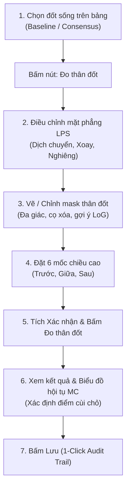

# Hướng dẫn Sử dụng Hệ thống Phân tích CT Cột sống (User Guide)

Tài liệu hướng dẫn toàn diện dành cho bác sĩ, kỹ thuật viên và người dùng nghiên cứu để thực hiện đầy đủ các tính năng của hệ thống: xem ảnh CT đa mặt phẳng, định vị đốt sống tự động, đánh giá độ ổn định với nhiễu HU, đo hình thái thân đốt sống và phân tích diện tích bè xương bằng Monte Carlo.

---

## 1. Khởi động ứng dụng

1. Đảm bảo máy tính đã được cài đặt môi trường theo [Hướng dẫn cài đặt Windows](windows_integration.md).
2. Tại thư mục gốc của dự án, nhấp đúp vào tệp:
   ```text
   start_demo.bat
   ```
   *(Hoặc mở PowerShell tại gốc dự án và chạy: `.\.venv\Scripts\python.exe -m apps.demo`)*
3. Giao diện chính **SPINAL CT / Research Review** sẽ xuất hiện với 3 phân khu chính:
   - **Cột trái:** Điều khiển nạp dữ liệu CT (`01`), cấu hình xử lý (`02`), và quản lý kết quả (`03`).
   - **Khu vực trung tâm:** Trình xem tương tác 3 mặt phẳng trực giao (**Axial**, **Sagittal**, **Coronal**).
   - **Bên dưới:** Bảng danh sách các đốt sống, tab lưu ý kết quả và tiến trình.

---

## 2. Nạp dữ liệu CT & Quản lý danh tính bệnh nhân (Mục 01)

### 2.1. Các hình thức mở dữ liệu CT
Nhấp vào nút **`Mở CT…`** ở góc trên bên trái để chọn định dạng phù hợp:
* **File NIfTI / NPY…:** Mở tệp thể tích 3D `.nii`, `.nii.gz` hoặc tệp mảng cường độ `.npy` (kèm tệp `metadata.json` cùng thư mục).
* **Thư mục DICOM…:** Mở thư mục chứa ảnh chụp cắt lớp vi tính xuất từ máy CT (hỗ trợ đọc đệ quy qua các thư mục con của máy như `csc/`, `exam/`, `ddv/`...).
* **Mở ca mẫu (`Mở ca mẫu · [Tên ca mẫu]`):** Nạp nhanh ca CT mặc định được cấu hình trong `sample_config.py`.

### 2.2. Chọn Series chụp (đối với DICOM)
Nếu thư mục chứa nhiều lần chụp (series), hộp chọn **Series** sẽ tự động hiển thị:
* Xem thông tin tóm tắt: Số lát cắt, kích thước ma trận (`512×512`), kernel tái tạo (`B70s`, `B26f`...), bề dày lát cắt.
* Chọn series dựng hình xương/phổi có chất lượng phù hợp và bấm **`Đọc series đã chọn`**.

### 2.3. Quản lý danh tính bệnh nhân & Chức năng Đổi tên
* **Tự động nhận diện:** Hệ thống tự động trích xuất thông tin bệnh nhân từ DICOM Tag (`PatientName`, `PatientID`) hoặc tự động leo ngược cây thư mục để tìm tên bệnh nhân (bỏ qua các mã kỹ thuật của máy CT như mã lô `A1`, `A3`, mã băm Siemens Syngo `MBBN3ULK`, mã ngôn ngữ `en-GB`).
* **Hiển thị nhãn:** Nhãn `Bệnh nhân: <Tên hiển thị> (<slug>)` sẽ xuất hiện rõ ràng với màu xanh đậm nổi bật.
* **Đổi tên / Khắc phục tên ẩn danh:** Bấm nút **`Đổi tên…`** bên cạnh nhãn bệnh nhân để nhập tên thực tế. Hệ thống sẽ:
  1. Cập nhật tên hiển thị (`display_name`) và mã an toàn thư mục (`slug`).
  2. Tự động đổi tên thư mục kết quả đã lưu trong `data/output/` tương ứng mà không làm gián đoạn phiên làm việc.

---

## 3. Định vị cột sống tự động (Mục 02)

Sau khi dữ liệu CT hợp lệ được nạp, hệ thống sẽ kiểm tra HU và hình học không gian (geometry).

### 3.1. Lựa chọn cấu hình mô hình
* **Độ phân giải:**
  * **Chi tiết · 1,5 mm (Mặc định - Khuyên dùng):** Ưu tiên độ mịn và chính xác của đường biên giải phẫu, tự động bật *robust crop 3 mm* để định vị vùng cắt tối ưu. Chạy lâu hơn và cần nhiều RAM hơn.
  * **Nhanh · 3 mm:** Mô hình 3 mm phục vụ kiểm tra sơ bộ nhanh chóng hoặc dùng cho máy có cấu hình phần cứng hạn chế.
* **Thử nghiệm nhiễu HU (Monte Carlo Input Perturbation):**
  * Nhấp mở rộng `+ Thử nghiệm nhiều HU` và tích chọn **`Bổ sung Monte Carlo nhiều HU`**.
  * Cấu hình số mẫu (mặc định: `2`), độ lệch chuẩn nhiễu `sigma (HU)` (mặc định: `20.00`) và `Seed`.
  * Tính năng này giúp đánh giá độ nhạy và tính bất biến của mô hình phân đoạn trước các biến thiên nhiễu chụp thực tế.

### 3.2. Thực thi định vị
1. Nhấp nút **`Chạy định vị`**.
2. Theo dõi tiến trình trong tab **Tiến trình** và thanh trạng thái thời gian thực.
3. Nếu muốn dừng quá trình giữa chừng, bấm **`Dừng sau lượt xử lý hiện tại`** (hệ thống sẽ hoàn tất mẫu đang chạy dở rồi dừng an toàn, không làm hỏng dữ liệu).

---

## 4. Khảo sát đa mặt phẳng (MPR) & Kiểm tra kết quả (Mục 03)

### 4.1. Tương tác hình ảnh 3 mặt phẳng
* **3 khung nhìn trực giao:**
  * **Axial (z):** Mặt phẳng cắt ngang (đầu ↔ chân).
  * **Sagittal (x):** Mặt phẳng đứng dọc (trước ↔ sau, nhìn từ bên hông).
  * **Coronal (y):** Mặt phẳng đứng ngang (trái ↔ phải, nhìn từ trước).
* **Đồng bộ vị trí bằng 1 cú nhấp:** Nhấp chuột trái vào bất kỳ vị trí giải phẫu nào trên một mặt phẳng, hai mặt phẳng còn lại sẽ tự động cuộn đến đúng tọa độ 3D tương ứng.
* **Thanh cuộn lát cắt:** Kéo các thanh trượt bên dưới hình để xem từng lát cắt theo trục z, x, y.

### 4.2. Tùy chỉnh trực quan hóa
* **Hiện overlay:** Bật/tắt lớp mặt nạ phân đoạn màu của các đốt sống.
* **Tên đốt sống:** Hiển thị nhãn tên đốt (C1–S1) kèm đường dẫn tới viền giải phẫu trên các lát Sagittal / Coronal.
* **Độ đậm:** Điều chỉnh thanh trượt độ trong suốt (opacity) của mask màu trên nền xương.
* **Cửa sổ sáng/tối (Windowing):**
  * `WL` (Window Level): Giá trị trung tâm cửa sổ HU (mặc định: `400` HU cho xương).
  * `WW` (Window Width): Độ rộng cửa sổ HU (mặc định: `1800` HU).

### 4.3. Chế độ hiển thị phân đoạn
* **Baseline:** Kết quả phân đoạn từ mô hình gốc không thêm nhiễu.
* **Consensus (Đồng thuận đa số):** Kết quả hợp nhất từ các lượt chạy Monte Carlo (vùng có ≥ 50% số mẫu đồng thuận).
* **Bất đồng:** Bản đồ nhiệt biểu diễn các vùng biên có sự sai khác giữa các lần thêm nhiễu.

### 4.4. Quản lý & Xuất kết quả định vị
* **`Tải lại lần chạy đã chọn`:** Khi mở một ca CT đã từng chạy trước đây, hệ thống tự động tìm thấy các lần chạy cũ trong `data/output/<slug>/dinh_vi_cot_song/` (cùng `data/demo_runs/`). Chọn trong danh sách và bấm tải lại mà không cần chạy lại.
* **`Duyệt kết quả khác từ máy…`:** Mở tệp `prediction.json` từ bất kỳ thư mục nào trên máy.
* **`Xuất báo cáo HTML`:** Xuất báo cáo định dạng web hoàn chỉnh gồm thông tin chụp, hình ảnh chụp 3 mặt phẳng và bảng thể tích chi tiết.
* **`Mở thư mục kết quả (Explorer)`:** Mở thẳng thư mục chứa kết quả định vị của lần chạy đang chọn.
* **`Mở thư mục đo thân đốt`:** Mở nhanh thư mục lưu trữ kết quả đo thân đốt của bệnh nhân hiện tại.

---

## 5. Quy trình Đo thân đốt sống & Phân tích diện tích bè xương

Tính năng cho phép bác sĩ khoanh vùng thân đốt sống (vertebral body) trên mặt phẳng giải phẫu thực, loại trừ cuống sống và cung sau, tính diện tích thực, ước lượng diện tích bè xương bằng Monte Carlo và xác định điểm cùi chỏ hội tụ.



### Bước 1: Mở công cụ đo
1. Trên bảng kết quả định vị, nhấp chọn hàng đốt sống cần đo (ví dụ: `L1`, `L2`...).
2. Đảm bảo đang ở chế độ xem **Baseline** hoặc **Consensus**.
3. Nhấp nút **`Đo thân đốt`** ở thanh điều hướng bên phải.

### Bước 2: Điều chỉnh mặt phẳng cắt thân đốt (Plane Alignment)
Mặt phẳng ban đầu được tự động chọn qua tâm giải phẫu của đốt:
1. Nhấp **`+ Điều chỉnh mặt phẳng`** để mở bảng điều khiển góc cắt.
2. Tùy chỉnh:
   * **Dịch mặt phẳng:** Dịch sang trái/phải theo mm.
   * **Xoay quanh trục đứng:** Xoay góc mặt phẳng (yaw) theo độ.
   * **Nghiêng mặt phẳng:** Nghiêng góc trước/sau (tilt) theo độ.
3. Bấm **`Tạo / áp dụng mặt phẳng`** để áp dụng. *(Nếu đổi ý, bấm `Giữ mặt phẳng hiện tại` để quay lại)*.
4. *Cơ chế bảo vệ dữ liệu:* Nếu bạn đã vẽ mask từ trước, hệ thống sẽ hỏi bạn muốn Lưu nháp, Bỏ qua hay Hủy trước khi đổi mặt phẳng.

### Bước 3: Khoanh vùng và chỉnh sửa mask thân đốt (2D Body Mask)
Vùng thân đốt cần bao gồm toàn bộ bè xương xốp và vỏ xương phía trước, loại trừ phần đĩa đệm và cung sau/cuống sống:
* **Vẽ / thêm vùng:** Bấm nút, nhấp các điểm liên tiếp quanh thân đốt, nhấp đúp hoặc bấm vào điểm đầu tiên để khép kín đa giác.
* **Bớt vùng:** Vẽ đa giác bao quanh phần muốn cắt bỏ (ví dụ phần mấu gai, mỏm khớp lọt vào).
* **Cọ vẽ / Cọ xóa:** Giữ chuột trái để tô thêm hoặc chuột phải để xóa tỉa từng chi tiết nhỏ.
* **Hoàn tác:** Nhấn `Ctrl + Z` để quay lại thao tác trước.
* **Gợi ý từ LoG (Laplacian of Gaussian):** Mở nhóm `+ Thử nghiệm LoG`, bấm **`Tìm ứng viên blob trong ROI`**. Các vòng tròn màu tím sẽ đánh dấu tâm và kích thước bè xương gợi ý giúp định vị nhanh.

### Bước 4: Đặt 6 mốc đo chiều cao đốt sống (Tùy chọn)
1. Mở nhóm **`Đo chiều cao · 6 mốc tùy chọn`**.
2. Bấm **`Đặt lại 6 mốc chiều cao`** và nhấp chuột lần lượt lên 6 vị trí:
   * 1. Trước – trên
   * 2. Trước – dưới
   * 3. Giữa – trên
   * 4. Giữa – dưới
   * 5. Sau – trên
   * 6. Sau – dưới
3. Nếu cần chỉnh sửa riêng 1 mốc: Chọn mốc trong danh sách, bấm **`Sửa mốc đã chọn`** và nhấp lại vị trí mới.

### Bước 5: Xác nhận và Chạy tính toán (Measure)
1. Chọn nhóm tuổi của bệnh nhân (nếu có thông tin).
2. Tích chọn ô **`Xác nhận mặt phẳng, mask và 6 mốc`**.
3. Bấm nút **`Đo thân đốt`**.
4. Quá trình tính toán diễn ra tự động trên luồng nền (`Task Worker`) không làm treo giao diện.

### Bước 6: Phân tích kết quả đo & Biểu đồ hội tụ Monte Carlo
Sau khi đo xong, bảng kết quả và 3 khung hình trực quan sẽ hiển thị đầy đủ:
* **Khung 1 (Vùng đo thân đốt):** Hiển thị ảnh CT lát cắt, mask thân đốt (xanh lá), ellipse moment tương đương và hộp bao vuông xoay theo trục chính.
* **Khung 2 (Chuẩn hóa 256 × 256):** Ảnh thân đốt đã được xoay thẳng trục, căn giữa và chuẩn hóa về kích thước $256 \times 256$ pixel giữ nguyên tỷ lệ thực.
* **Khung 3 (Biểu đồ hội tụ MC & Điểm cùi chỏ):**
  * Đường xanh dương: Diện tích ước lượng Monte Carlo theo số điểm lấy mẫu ($100 \to 10.000.000$ điểm).
  * Đường nét đứt đen: Diện tích đếm pixel giải phẫu tham chiếu.
  * Điểm màu cam (**Điểm cùi chỏ / Elbow Point**): Vị trí thuật toán phát hiện diện tích bắt đầu đạt trạng thái hội tụ ổn định, giúp bác sĩ biết số mẫu lấy mẫu tối ưu và diện tích tin cậy tương ứng.
* **Các chỉ số hình thái học:**
  * Diện tích đếm pixel ($mm^2$), Diện tích Monte Carlo ($mm^2$), Sai lệch so với đếm pixel ($mm^2$).
  * Chiều dài cạnh hộp bao vuông ($mm$), Tỷ lệ lấp đầy (Fill ratio), Độ lồi/đặc (Solidity).
  * Chiều cao thành trước, thành giữa, thành sau ($mm$) và các tỷ lệ chiều cao (Trước/Sau, Giữa/Sau).

### Bước 7: Lưu trữ 1-Click & Bảo toàn lịch sử (Audit Trail)
* **Nút `Lưu` (1-Click):** Tự động lưu bản ghi mới vào thư mục:
  ```text
  data/output/<slug>/do_than_dot/<level>_<timestamp>_<uuid>/
  ```
  *Bác sĩ có thể chỉnh sửa và lưu nhiều lần mà không bao giờ bị ghi đè, toàn bộ lịch sử các lần đo trước đều được bảo toàn trọn vẹn.*
* **Nút `Lưu khác…`:** Chọn thư mục lưu trữ tùy biến khác (ví dụ lưu ra USB hoặc ổ cứng ngoài).
* **Các tệp được xuất ra:**
  * `region.json`: Dữ liệu tọa độ mặt phẳng, trạng thái duyệt và chữ ký toàn vẹn.
  * `body_mask.npy`: Mảng mask nhị phân 2D của thân đốt.
  * `features.csv`: Toàn bộ chỉ số hình thái học và diện tích điểm cùi chỏ.
  * `preview.png`: Ảnh chụp 3 khung hình độ phân giải cao.
  * `report.html`: Báo cáo chẩn đoán hình ảnh định dạng HTML hoàn chỉnh.

---

## 6. Cấu trúc lưu trữ dữ liệu chuẩn hóa

Toàn bộ dữ liệu của dự án được phân cấp gọn gàng theo từng tên bệnh nhân:

Ví dụ cấu trúc thư mục:

```text
Diagnosis-System-for-Spinal-Lesions-Using-CT/
├── data/
│   ├── raw/                               # Dữ liệu ảnh CT gốc từ bệnh viện
│   │   └── A3/duong kim hoa/csc/...
│   └── output/                            # Dữ liệu kết quả phân tích theo bệnh nhân
│       └── duong_kim_hoa/                 # Thư mục riêng theo slug bệnh nhân
│           ├── dinh_vi_cot_song/          # Kết quả định vị cột sống
│           │   └── run_1.5mm_20261102_103139_290607/
│           │       ├── prediction.json
│           │       ├── vertebrae.nii.gz
│           │       ├── preview.png
│           │       └── report.html
│           └── do_than_dot/               # Kết quả các lần đo thân đốt sống
│               ├── L1_20261102_142015_a1b2c3/
│               │   ├── region.json
│               │   ├── body_mask.npy
│               │   ├── features.csv
│               │   ├── preview.png
│               │   └── report.html
│               └── L1_20261102_151030_e4f5a6/  # Lần đo lại (giữ lịch sử)
```

---

## 7. Giải thích các cảnh báo thường gặp

| Cảnh báo | Ý nghĩa lâm sàng / kỹ thuật | Hướng xử lý |
|---|---|---|
| `Chạm biên ảnh` | Đốt sống nằm sát lát cắt trên/dưới của trường chụp CT | Thể tích có thể thiếu hụt; đối chiếu lại chiều dài trường chụp thực tế |
| `indeterminate` | Kết quả nằm ở vùng ranh giới chuyển tiếp hoặc đốt chạm biên | Không phải lỗi phần mềm; cần xem tab *Lưu ý kết quả* và kiểm tra bằng mắt |
| `Vùng đo quá nhỏ` | Diện tích mask thân đốt vừa vẽ nhỏ hơn ngưỡng giải phẫu bình thường | Kiểm tra lại xem đã khép kín toàn bộ thân đốt hay chưa |
| `Vùng đo chạm biên mặt phẳng` | Đường bao thân đốt chạm sát mép khung cắt 2D | Mở *Điều chỉnh mặt phẳng* để căn giữa lại thân đốt trong khung hình |
| `Hướng ellipse chưa ổn định` | Hai trục chính của thân đốt gần bằng nhau (dạng tròn/vuông) | Góc xoay ellipse chỉ mang tính tham khảo, không ảnh hưởng đến phép đo diện tích |

---

## 8. Phím tắt và thao tác nhanh

* **Nhấp chuột trái trên ảnh CT:** Đồng bộ vị trí giải phẫu tức thì trên cả 3 mặt phẳng.
* **Cuộn con lăn chuột:** Di chuyển tiến/lùi qua các lát cắt.
* **`Ctrl + Z` (trong cửa sổ đo):** Hoàn tác bước vẽ mask hoặc đặt mốc vừa thực hiện.
* **`Esc` (trong cửa sổ đo):** Đóng cửa sổ (hệ thống sẽ tự động nhắc nhở nếu có thay đổi chưa lưu).

